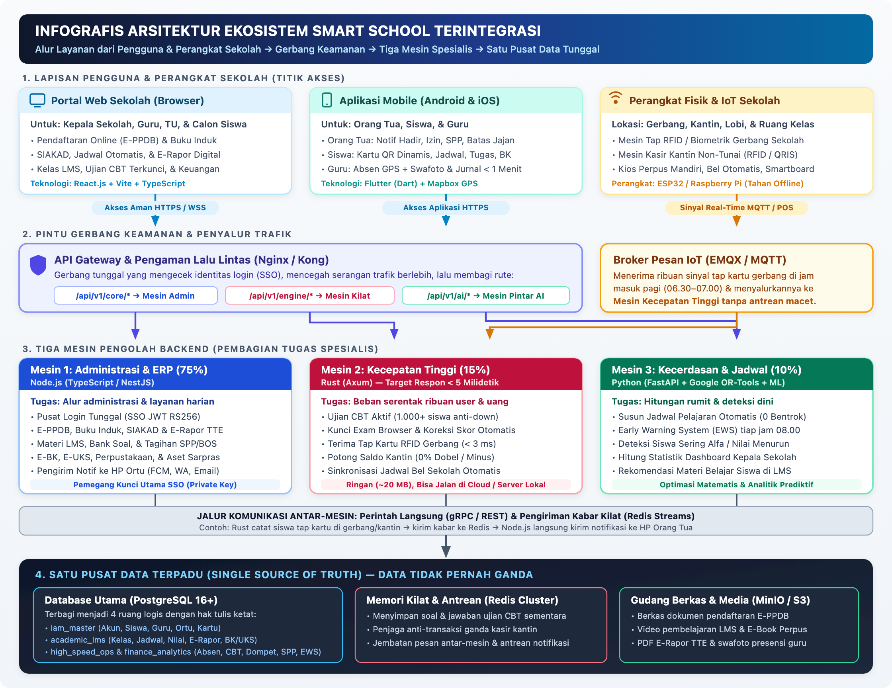
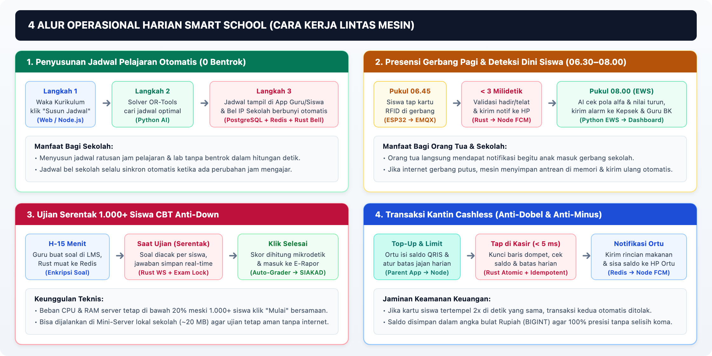

# Dokumen Arsitektur Pengembangan Aplikasi, Development Plan, dan Task List
## Ekosistem Smart School Terintegrasi (Hybrid Polyglot Architecture)

**Versi Dokumen:** 1.4.0  
**Tanggal:** 11 November 2026  
**Basis Referensi:** Cetak Biru (Blueprint) Ekosistem Smart School Terintegrasi (Ekstensi E-PPDB, Buku Induk, Master Data, SIAKAD, E-Rapor, Smart LMS ML, E-Finance, Layanan Kesiswaan, Perpustakaan, & Sarpras)  
**Arsitektur Target:** Polyglot Service-Oriented Architecture (Node.js/NestJS, Rust/Axum, Python/FastAPI)  

---

## Daftar Isi

1. [BAB 1: Ringkasan Eksekutif, Pilar, & Prinsip Arsitektur](#bab-1-ringkasan-eksekutif-pilar--prinsip-arsitektur)
2. [BAB 2: Arsitektur Sistem End-to-End & Topologi Layanan](#bab-2-arsitektur-sistem-end-to-end--topologi-layanan)
3. [BAB 3: Desain Mendalam Layanan Backend (Polyglot Services)](#bab-3-desain-mendalam-layanan-backend-polyglot-services)
4. [BAB 4: Desain Basis Data (Single Source of Truth) & Manajemen Penyimpanan](#bab-4-desain-basis-data-single-source-of-truth--manajemen-penyimpanan)
5. [BAB 5: Alur Proses Bisnis Kritis Lintas Layanan (Hybrid Workflows)](#bab-5-alur-proses-bisnis-kritis-lintas-layanan-hybrid-workflows)
6. [BAB 6: Arsitektur Aplikasi Klien (Web, Mobile Flutter, & IoT)](#bab-6-arsitektur-aplikasi-klien-web-mobile-flutter--iot)
7. [BAB 7: Keamanan, Infrastruktur, Deployment, & Observability](#bab-7-keamanan-infrastruktur-deployment--observability)
8. [BAB 8: Development Plan (Rencana Pengembangan 12 Bulan / 24 Sprint)](#bab-8-development-plan-rencana-pengembangan-12-bulan--24-sprint)
9. [BAB 9: Task List & Work Breakdown Structure (WBS)](#bab-9-task-list--work-breakdown-structure-wbs)

---

## BAB 1: Ringkasan Eksekutif, Pilar, & Prinsip Arsitektur

### 1.1 Tujuan dan Empat Pilar Ekosistem
Dokumen ini menjabarkan spesifikasi arsitektur pengembangan aplikasi, rencana eksekusi 12 bulan, serta daftar tugas (*task list*) implementasi **Ekosistem Smart School Terintegrasi**. Sistem dirancang untuk menopang empat pilar utama operasional sekolah modern:

1. **Integrasi Akademik**: Penyatuan data mulai dari penerimaan siswa (E-PPDB), Buku Induk Digital, SIAKAD, LMS, CBT, hingga E-Rapor ber-Tanda Tangan Elektronik (TTE) tanpa *data silos*.
2. **Kemudahan Layanan Siswa & Orang Tua**: Akses terpadu melalui Mobile Super-App untuk absensi *real-time*, pemantauan nilai, pengajuan izin, pembayaran SPP, hingga dompet *cashless* kantin dengan batas jajan harian.
3. **Efisiensi Kerja Guru & Tendik**: Penyusunan jadwal pelajaran otomatis bebas bentrok, presensi berbasis GPS + swafoto, pengisian jurnal mengajar di bawah 1 menit, serta *auto-grading* ujian CBT.
4. **Transparansi Manajemen Sekolah**: Dashboard Eksekutif bagi Kepala Sekolah dan Yayasan yang dilengkapi *Early Warning System* (EWS) untuk deteksi dini risiko akademik dan kedisiplinan siswa, serta transparansi tata kelola keuangan (SPP & dana BOS).

### 1.2 Tiga Prinsip Mutlak Arsitektur
Seluruh keputusan teknis dan desain modul wajib mematuhi tiga prinsip mutlak berikut:

| Prinsip | Implementasi Teknis | Dampak Operasional |
| :--- | :--- | :--- |
| **1. Single Source of Truth (SSOT)** | Satu klaster **PostgreSQL 16+** sebagai pusat data tunggal yang dipecah ke dalam 4 skema logis (`iam_master`, `academic_lms`, `high_speed_ops`, `finance_analytics`) dengan aturan *Write Ownership* yang ketat. | Perubahan di satu titik (mis. kelulusan E-PPDB) otomatis memperbarui Buku Induk, akun LMS, dan dompet kantin tanpa input ulang dan menjaga integritas *Foreign Key*. |
| **2. Single Sign-On (SSO) & RBAC** | Satu kredensial akun untuk seluruh warga sekolah (Kepala Sekolah, Guru, Staf TU, Siswa, Orang Tua, Merchant) menggunakan token **JWT Asimetris (RS256)**. | `private.pem` hanya dipegang Service A (Node.js); Service B (Rust) dan Service C (Python) memverifikasi token secara lokal memakai `public.pem` (*read-only*) tanpa beban kueri DB. |
| **3. Polyglot Service-Oriented Architecture** | Pemisahan beban kerja backend ke tiga runtime sesuai karakteristik komputasi: **Node.js (NestJS)** ~75%, **Rust (Axum)** ~15%, dan **Python (FastAPI)** ~10%. | Mencegah kegagalan server saat *burst traffic* (ujian CBT serentak, tap RFID pagi, jam istirahat kantin) sekaligus menjaga kecepatan pengembangan fitur ERP. |

### 1.3 Target Non-Functional Requirements (NFR) & SLA

| Parameter | Target SLA / Batas Kinerja | Komponen Penanggung Jawab |
| :--- | :--- | :--- |
| **Latensi Ingesti IoT RFID** | `< 3 ms` per event validasi tap kartu (MQTT → DB/Cache → Event) | Service B (Rust / Axum) + EMQX |
| **Latensi Transaksi POS Kantin** | `< 5 ms` per transaksi potong saldo atomik (`FOR UPDATE`) | Service B (Rust / Axum) + PostgreSQL |
| **Kapasitas Ujian CBT Serentak** | `≥ 1.000` siswa aktif bersamaan per node dengan utilisasi CPU & RAM `< 20%` | Service B (Rust) + Redis Cluster |
| **Latensi API ERP Standar** | `P95 < 200 ms` untuk endpoint CRUD SIAKAD, PPDB, Keuangan | Service A (Node.js / NestJS) |
| **Keandalan Finansial POS** | `0%` saldo minus, `0%` *double-deduct* (*race condition* / *double-tap*) | Rust + PostgreSQL `BIGINT` + `idempotency_key` |
| **Resiliensi Offline Perangkat** | Terminal ESP32 menyimpan antrean tap di *flash* lokal & *batch sync* otomatis | Firmware ESP32 + Rust Batch Endpoint |
| **Fleksibilitas Deployment Edge** | Binari kompilasi Rust `~20 MB` siap deploy di Cloud VPS maupun Mini-Server On-Premise | Service B (Rust Static/Minimal Binary) |

---

## BAB 2: Arsitektur Sistem End-to-End & Topologi Layanan

### 2.1 Infografis Arsitektur Ekosistem (Gambaran Umum & Teknis)

Agar mudah dipahami baik oleh manajemen sekolah (non-teknis) maupun tim pengembang, sistem ini bekerja layaknya **gedung layanan terpadu dengan satu pintu masuk dan satu brankas data**:

1. **Lapisan Pengguna & Perangkat:** Kepala Sekolah, Guru, Staf TU, Siswa, dan Orang Tua mengakses sistem melalui **Web** atau **Aplikasi HP**, sementara aktivitas fisik di sekolah (tap kartu gerbang, kasir kantin, kios perpus, bel sekolah) ditangani oleh **Perangkat IoT**.
2. **Pintu Gerbang Keamanan:** Seluruh permintaan masuk diperiksa terlebih dahulu oleh **API Gateway** (untuk Web/Mobile) dan **Broker EMQX** (untuk ribuan sinyal IoT) agar aman dan langsung diarahkan ke mesin yang tepat.
3. **Tiga Mesin Spesialis:** Beban kerja dibagi rata ke tiga mesin sesuai keahliannya—**Mesin Administrasi** (*Node.js*, 75% fitur harian), **Mesin Kecepatan Tinggi** (*Rust*, 15% fitur padat seperti ujian CBT serentak, tap gerbang, dan kasir kantin `< 5 ms`), serta **Mesin Kecerdasan & Jadwal** (*Python*, 10% fitur penjadwalan otomatis & deteksi dini siswa).
4. **Satu Pusat Data Terpadu (SSOT):** Ketiga mesin menyimpan dan membaca data dari satu pusat penyimpanan tunggal (**PostgreSQL**, **Redis**, dan **MinIO**) sehingga tidak pernah terjadi data ganda.



### 2.2 Spesifikasi API Gateway & Routing

API Gateway (Kong atau Nginx) menjadi satu-satunya titik masuk HTTP/HTTPS/WebSocket dari jaringan publik:

| Prefix Rute | Layanan Tujuan | Kebijakan Rate Limit & Timeout | Catatan Khusus |
| :--- | :--- | :--- | :--- |
| `/api/v1/core/auth/*` | Service A (Node.js) | Ketat (mis. `20 req/menit/IP` untuk login/OTP) | Proteksi *brute-force* & *credential stuffing* |
| `/api/v1/core/webhooks/*` | Service A (Node.js) | Whitelist IP Payment Gateway + HMAC Signature | Bypass rate limit user, validasi tanda tangan wajib |
| `/api/v1/core/*` | Service A (Node.js) | `120 req/menit/user`, timeout `30s` (ekspor/TTE `60s`) | Upload file besar diarahkan via S3/MinIO *Presigned URL* |
| `/api/v1/engine/cbt/*` | Service B (Rust) | Burst tinggi (`100 req/detik/kelas`), WebSocket upgrade | Koneksi persisten untuk sinkronisasi jawaban & *heartbeat* |
| `/api/v1/engine/pos/*` | Service B (Rust) | `60 req/detik/terminal`, timeout `5s` | Wajib menyertakan header `Idempotency-Key` |
| `/api/v1/engine/iot/*` | Service B (Rust) | Autentikasi mTLS / Device API Key | Jalur *batch sync* untuk perangkat ESP32 saat pulih offline |
| `/api/v1/ai/*` | Service C (Python) | `30 req/menit/user`, timeout `10s` (async job) | Tugas berat dijalankan asinkron dan dilaporkan via Redis |

### 2.3 Topologi Broker IoT (EMQX / MQTT)

EMQX melayani komunikasi mesin-ke-mesin berlatensi rendah di lingkungan sekolah:
- **Protokol**: MQTT v5.0 over TLS (port `8883`) atau TCP internal VLAN IoT (`1883`).
- **Struktur Topik Standar**:
  - `school/{school_id}/gate/{device_id}/attendance` (QoS 1 — *at least once* untuk menjamin tap kartu tidak hilang).
  - `school/{school_id}/gate/{device_id}/ack` (QoS 0 — balasan status LED/buzzer terminal: Hijau/Merah/Terlambat).
  - `school/{school_id}/bell/{device_id}/schedule` (QoS 1, *Retained* — jadwal bunyi bel terbaru).
  - `school/{school_id}/device/{device_id}/heartbeat` (QoS 0 — status kesehatan & *firmware version* setiap 60 detik).
- **Integrasi ke Service B**: Rust menjalankan *shared subscription* (`$share/rust_workers/school/+/gate/+/attendance`) sehingga beberapa replika pod Rust dapat membagi beban ratusan pesan per detik secara paralel tanpa duplikasi pemrosesan.

---

## BAB 3: Desain Mendalam Layanan Backend (Polyglot Services)

### 3.1 Service A — Core ERP & Academic Service (`Node.js / TypeScript / NestJS`)

Menangani **~75% cakupan fungsional** aplikasi yang berfokus pada logika bisnis kompleks, alur persetujuan, manajemen dokumen, dan integrasi pihak ketiga.

- **Tanggung Jawab Utama**:
  1. **Pusat SSO & IAM**: Registrasi/aktivasi akun warga sekolah, manajemen RBAC (Role, Permission, Role Assignment), penerbitan JWT RS256 (Access Token berumur pendek 15 menit + Refresh Token rotasi di Redis), manajemen *pin* transaksi kantin, serta manajemen siklus kartu identitas (`identity_cards`).
  2. **E-PPDB & Buku Induk Digital**:
     - *E-PPDB*: Konfigurasi gelombang/kuota/syarat dokumen dinamis, portal pendaftaran *multi-step* (*save draft*), *geotagging* zonasi (Haversine), *duplicate guard* NIK/NISN, integrasi tagihan formulir & daftar ulang (VA/QRIS), desk verifikasi *split-view* dengan status & revisi per dokumen, pembobotan skor & orkestrasi *Placement Test* dari Rust CBT, pengumuman terjadwal + SKL ber-QR, *waiting list* otomatis, serta **One-Click & Batch Migration** dengan generator NIS terstruktur.
     - *Buku Induk Digital*: Profil induk lengkap standar Dapodik/EMIS (identitas kependudukan, domisili/transportasi, data terpisah Ayah/Ibu/Wali, kesehatan/E-UKS, KIP/PIP), brankas arsip legalitas MinIO (*versioning* & audit), manajemen kartu identitas RFID/QR, tampilan **Buku Induk 360° lintas tahun** (riwayat rombel, nilai/E-Rapor TTE, presensi/EWS, prestasi/E-BK), siklus mutasi masuk/keluar, kenaikan kelas & kelulusan massal ke Alumni, pengajuan ubah data mandiri + approval TU, cetak PDF Buku Induk & surat resmi ber-QR/TTE (terhubung ke Kiosk), serta impor massal & *pre-flight validator* Dapodik/EMIS.
  3. **Master Data, SIAKAD, & E-Rapor**:
     - *Master Data*: Profil sekolah & pejabat penandatangan TTE, tahun ajaran & kalender akademik (libur/ujian), multi-kurikulum (Kurikulum Merdeka/K-13) & fase, mata pelajaran + bank CP/TP & KKTP, GTK/PTK + beban JP + preferensi jadwal OR-Tools, ruang/lab & slot jam bel, rombel reguler & mapel pilihan, ekstrakurikuler & projek P5, serta formula bobot nilai & skala predikat.
     - *SIAKAD*: Plotting guru & SK pembagian tugas, orkestrasi jadwal OR-Tools + editor manual + guru pengganti/piket, jurnal mengajar & presensi per jam pelajaran, monitoring keterlaksanaan KBM, manajemen rombel lintas periode/mapel pilihan, administrasi ujian sekolah & jadwal pengawas, rekap presensi & approval izin orang tua, serta sidang kenaikan kelas/kelulusan & sinkronisasi Dapodik/EMIS.
     - *E-Rapor*: Perencanaan penilaian berbasis TP/kompetensi, input nilai massal/Excel + *auto-sync* nilai LMS & Rust CBT (`CbtExamSubmitted`), remedial & pengayaan, generator deskripsi capaian otomatis, rapor P5 & sikap, integrasi ekskul/prestasi/absensi S-I-A otomatis, workspace wali kelas + mekanisme *Lock/Unlock* nilai Waka Kurikulum, leger nilai & analitik peringkat, cetak PDF E-Rapor ber-TTE & QR verifikasi, serta *bridge* ekspor e-Rapor Kemendikbud/RDM Kemenag.
  4. **Smart LMS (Dynamic Course & Adaptive Learning Management)**: Sinkronisasi kelas otomatis dari SIAKAD (`teaching_assignments`), penyusunan modul dinamis berbasis *Content Blocks* (`TEXT_LATEX`, `INTERACTIVE_VIDEO` MinIO, `DOC_SLIDE`, `SIMULATION_EMBED`, `FORMATIVE_QUIZ`, `ASSIGNMENT_RUBRIC`) yang ditandai dengan metadata pedagogis (`tp_id`, level Bloom `C1–C6`, tingkat kesulitan), aturan *Conditional Release* (jalur remedial/pengayaan adaptif), template MGMP, forum/live hybrid, manajemen **Bank Soal AKM** (`cbt_exams`, `cbt_questions`), serta pengumpulan telemetri belajar untuk analitik ML di Service C.
  5. **E-Finance, Akuntansi, & Payroll Sekolah**: Manajemen komponen tarif/beasiswa & cicilan (`fee_structures`, `fee_discounts`), tagihan massal & ad-hoc (`invoices`), multi-channel payment (VA, QRIS, e-Wallet, loket tunai) + verifikasi **HMAC Webhook** & rekonsiliasi mutasi bank, *dunning* tunggakan otomatis, perencanaan & realisasi **RKAS/Dana BOS** (*approval* berjenjang + SPJ MinIO), akuntansi jurnal ganda (*double-entry* CoA ISAK 35/PSAK 45), **Payroll GTK** (terintegrasi honor JP SIAKAD), serta rekonsiliasi *settlement* merchant kantin.
  6. **Layanan Kesiswaan, Perpustakaan (E-Library), & Manajemen Sarpras**:
     - *Layanan Kesiswaan*: E-BK terpadu (tata tertib poin pelanggaran/prestasi, eskalasi SP/Home Visit, booking konseling, & catatan konseling terenkripsi **AES-256-GCM**), E-UKS (rekam kunjungan terenkripsi, sinkron alergi Buku Induk, screening berkala, & stok obat), manajemen Ekstrakurikuler/OSIS/dispensasi lomba, pengelolaan beasiswa/KIP-PIP, serta Direktori Alumni, legalisir QR, & **Tracer Study**.
     - *Perpustakaan (E-Library)*: Katalogisasi klasifikasi DDC & barcode per eksemplar (`library_copies`), portal OPAC & antrean reservasi buku, sirkulasi cepat & **Self-Service Kiosk**, denda otomatis terintegrasi dompet *cashless* (`LIBRARY_FINE`), E-Book reader terproteksi DRM *watermark*, stok opname, distribusi buku paket kelas, & verifikasi **Bebas Pustaka** kelulusan/mutasi.
     - *Manajemen Aset & Sarpras*: Registrasi inventaris ber-QR/NFC standar **KIB A–F / BMD** & lokasi hierarkis (gedung/lantai/ruang), pengadaan/PO/BAPP & BAST mutasi aset, **Booking Ruangan & Lab anti-bentrok** (`schedules`), peminjaman alat, jadwal *Preventive Maintenance* & *helpdesk ticketing* via scan QR, manajemen **Barang Habis Pakai (BHP)**, audit stok opname, penyusutan (*depreciation*), & berita acara penghapusan/afkir aset.
  7. **Notification Dispatcher & Event Consumer**: Mengonsumsi Redis Streams (`AttendanceRecorded`, `WalletDeducted`, `ScheduleGenerated`, `EwsAlertRaised`) dan mendistribusikan notifikasi melalui **Firebase Cloud Messaging (FCM)**, **WhatsApp Gateway**, dan **Email** menggunakan antrean **BullMQ** agar pengiriman bervolume tinggi tidak memblokir API utama.

- **Struktur Direktori Modular yang Disarankan (`services/core-erp`)**:
  ```text
  src/
  ├── common/             # Guards (RS256 JWT, RBAC), Interceptors, AES-256-GCM, MinIO, Redis
  ├── modules/
  │   ├── iam/            # Auth, Users, Roles, Identity Cards
  │   ├── ppdb/           # Pendaftaran, Verifikasi, One-Click Migration
  │   ├── siakad/         # Buku Induk, Rombel, Jadwal, Nilai, E-Rapor TTE, Dapodik
  │   ├── lms/            # Smart LMS Dinamis, Tugas, Forum, Bank Soal AKM/CBT
  │   ├── finance/        # Billing, VA/QRIS, Dunning, RKAS/BOS, Jurnal Ganda, Payroll, Settlement
  │   ├── student-care/   # E-BK, Tata Tertib/Prestasi, E-UKS, Ekskul/OSIS, Beasiswa, Alumni Tracer
  │   ├── library/        # OPAC, Eksemplar Barcode/RFID, Sirkulasi, Kiosk, Denda, E-Book DRM
  │   ├── sarpras/        # Aset KIB/QR, Pengadaan/BAPP, Booking Ruang, BHP, Maintenance, Afkir
  │   └── notifications/  # Redis Stream Consumers + BullMQ Dispatchers (FCM/WA/Email)
  └── main.ts
  ```

#### 3.1.1 Matriks Spesifikasi Fitur Wajib E-PPDB & Buku Induk Digital

| Modul | Klaster Fitur | Rincian Fungsionalitas Wajib |
| :--- | :--- | :--- |
| **E-PPDB** | **1. Setup Gelombang & Kuota** | Multi-gelombang (Inden, Gel 1, Gel 2), jadwal otomatis per fase, kuota daya tampung per jenjang/jalur (`ZONASI`, `PRESTASI`, `AFIRMASI`, `MUTASI`, `REGULER`), aturan berkas wajib dinamis per jalur, tarif & kode voucher/beasiswa. |
| **E-PPDB** | **2. Portal Publik & Zonasi** | Formulir *multi-step wizard* + *save draft*, pendaftaran kolektif *feeder school*, *duplicate guard* NIK/NISN, pemilih peta koordinat rumah + kalkulator jarak Haversine otomatis, unggah berkas MinIO *presigned URL*. |
| **E-PPDB** | **3. Billing & Daftar Ulang** | Tagihan otomatis `PPDB_FEE` & `DAFTAR_ULANG_FEE` (VA/QRIS), buka kunci kartu peserta ujian saat lunas, dukungan cicilan & potongan beasiswa/anak guru/yatim. |
| **E-PPDB** | **4. Verifikasi & Revisi** | Desk verifikasi *split-view* (data vs preview MinIO), status & catatan per dokumen (`APPROVED`, `NEED_REVISION`, `REJECTED`), notifikasi WA/Email/FCM untuk unggah ulang dokumen yang ditolak tanpa daftar ulang. |
| **E-PPDB** | **5. Seleksi & Placement Test** | Kalkulator skor zonasi (jarak + usia) & prestasi (nilai rapor + bobot piagam), integrasi *Placement Test* via **Service B (Rust CBT)** (`CbtExamSubmitted`), input nilai wawancara, papan peringkat & pelimpahan sisa kuota. |
| **E-PPDB** | **6. Pengumuman & Cadangan** | Rilis kelulusan terjadwal (*embargo*), cetak SKL PPDB ber-QR/TTE, konfirmasi daftar ulang (seragam & pernyataan), serta promosi otomatis dari *waiting list* jika peserta diterima mengundurkan diri. |
| **E-PPDB** | **7. One-Click & Batch Migration** | Generator NIS terstruktur, migrasi atomik ke Buku Induk, penautan multi-anak ke 1 akun `ORANG_TUA`, aktivasi dompet kantin + kartu RFID/QR, penempatan rombel awal seimbang, & pembekuan arsip dokumen PPDB. |
| **E-PPDB** | **8. Dashboard & Audit Trail** | Funnel konversi pendaftar *real-time*, peta sebaran asal sekolah, proyeksi kuota, dan log audit seluruh aksi verifikasi/kelulusan/migrasi. |
| **Buku Induk** | **1. Profil Standar Dapodik/EMIS** | Identitas lengkap (NIS, NISN, NIK, No. KK, No. Akta, anak ke-, agama, disabilitas), alamat rinci + koordinat + transportasi, data terpisah Ayah/Ibu Kandung/Wali, data periodik kesehatan/alergi (E-UKS), & status KIP/PIP/PKH. |
| **Buku Induk** | **2. Asal Sekolah & Brankas Arsip** | Riwayat sekolah asal (NPSN, nomor ijazah/SKL sebelumnya), penyimpanan arsip digital MinIO (*pas foto berkala, KK, Akta, Ijazah, Surat Pindah*) dengan *versioning* & audit akses. |
| **Buku Induk** | **3. NIS & Kartu Identitas** | Generator NIS berurutan, validasi anti-duplikat NIK/NISN, cetak Kartu Pelajar fisik & Dynamic QR, serta alur ganti kartu hilang (blokir UID lama & invalidasi cache Redis `iam:rfid:*`). |
| **Buku Induk** | **4. Buku Induk 360° Lintas Tahun** | Halaman timeline terpadu per siswa: riwayat rombel & wali kelas tiap semester, transkrip nilai & arsip PDF E-Rapor TTE, rekap presensi + skor EWS, prestasi/ekskul, & ringkasan poin E-BK. |
| **Buku Induk** | **5. Mutasi, Kenaikan, & Kelulusan** | Alur Mutasi Masuk (pindahan), Mutasi Keluar/DO (surat pindah ber-QR, nonaktif RFID/rombel, *settlement* dompet), Kenaikan Kelas Massal, & Kelulusan Massal (nomor ijazah, status `GRADUATED`, transisi ke Alumni). |
| **Buku Induk** | **6. Self-Service & Approval TU** | Pengajuan pembaruan biodata/dokumen oleh orang tua/siswa dari Web/Parent App; perubahan identitas legal masuk antrean persetujuan Staf TU/Operator Dapodik. |
| **Buku Induk** | **7. Cetak Buku Induk & Surat** | Cetak PDF Lembar Buku Induk resmi (satuan/angkatan) & generator surat ber-QR/TTE (Surat Aktif via Kiosk, Kelakuan Baik, Surat Pindah, SKL). |
| **Buku Induk** | **8. Impor & Validator Dapodik** | Impor massal Excel/CSV siswa lama, *Pre-Flight Completeness Validator* (deteksi NIK/NISN/Ibu Kandung kosong), & ekspor XLSX/CSV siap unggah Dapodik/EMIS. |

#### 3.1.2 Matriks Spesifikasi Fitur Wajib Master Data, SIAKAD, & E-Rapor

| Modul | Klaster Fitur | Rincian Fungsionalitas Wajib |
| :--- | :--- | :--- |
| **Master Data** | **1. Profil Sekolah & Pejabat TTE** | NPSN, NSS, kop surat, logo, akreditasi, data Kepala Sekolah aktif (NIP & sertifikat TTE/BSrE), serta tanggal titimangsa pembagian rapor per semester. |
| **Master Data** | **2. Kalender Akademik & Periode** | Tahun ajaran (`ODD`/`EVEN`), tanggal efektif KBM, daftar hari libur nasional/sekolah (mencegah salah catat `ALPHA`), jadwal STS/SAS/Ujian Sekolah, & jadwal bagi rapor. |
| **Master Data** | **3. Kurikulum, Fase, & CP/TP** | Dukungan multi-kurikulum (*Kurikulum Merdeka* Fase A–F & *K-13*), kelompok mapel (Wajib/Pilihan/Mulok/Kejuruan), jam tatap muka (JP), KKTP/KKM, & bank Capaian/Tujuan Pembelajaran (CP/TP). |
| **Master Data** | **4. GTK/PTK, Ruang, & Slot Bel** | Data GTK standar Dapodik (NIP/NUPTK, linieritas, batas JP), preferensi jam kosong OR-Tools, master ruang kelas/lab beserta kapasitas, serta konfigurasi slot JP & variasi jadwal hari Jumat. |
| **Master Data** | **5. Rombel, Ekskul, P5, & Formula Nilai** | Master rombel reguler & mapel pilihan, daftar ekstrakurikuler + pembina, tema & dimensi Projek P5, formula bobot nilai akhir (Formatif/Sumatif/SAS), & interval predikat (`A/B/C/D`). |
| **SIAKAD** | **1. Plotting Guru & Beban JP** | Penetapan guru pengampu per `(Rombel, Mapel)`, validasi pemenuhan jam wajib sertifikasi (mis. 24 JP), penugasan Wali Kelas/Pembina, & cetak draf SK Pembagian Tugas Mengajar. |
| **SIAKAD** | **2. Penjadwalan Pintar & Piket** | Pemodelan kendala ke `solve_timetable` (Python OR-Tools), editor manual *drag-and-drop* anti-bentrok, manajemen **Guru Pengganti/Piket** harian, & sinkronisasi jadwal ke IP Bell (Rust). |
| **SIAKAD** | **3. Jurnal KBM & Presensi Mapel** | Jurnal mengajar `< 1 menit` (`teaching_journals`), presensi per jam pelajaran (bedakan dispensasi lomba/izin dari absen gerbang), & dashboard monitoring keterlaksanaan KBM bagi Waka Kurikulum. |
| **SIAKAD** | **4. Mapel Pilihan, Ujian, & Izin** | Pengelolaan kelas mapel pilihan lintas rombel, penjadwalan ruang & pengawas ujian sekolah + kartu ujian, serta rekap absen RFID + approval izin/sakit orang tua oleh Wali Kelas. |
| **SIAKAD** | **5. Sidang Kenaikan & Dapodik** | Rapat pleno kenaikan kelas digital (*early warning* dari EWS Python), pencatatan status akhir periode (`Naik`/`Tinggal`/`Lulus`), & sinkronisasi/ekspor resmi Dapodik/EMIS. |
| **E-Rapor** | **1. Perencanaan & Input Nilai + Sync** | Pemilihan TP per semester, grid input massal & impor template Excel, serta **Auto-Sync** skor ujian CBT Rust (`cbt_student_submissions`) & nilai tugas LMS tanpa input ulang. |
| **E-Rapor** | **2. Remedial & Deskripsi Otomatis** | Penandaan otomatis siswa di bawah KKTP, pencatatan histori nilai remedial/pengayaan, serta generator narasi deskripsi capaian otomatis berbasis TP tertinggi & terendah (dapat disunting guru). |
| **E-Rapor** | **3. Projek P5, Ekskul, & Absensi** | Penilaian dimensi Projek P5 (*MB/SB/BSH/SAB*) & sikap, input nilai/deskripsi oleh pembina ekskul, penarikan otomatis daftar prestasi E-BK, serta rekap S/I/A otomatis dari presensi SIAKAD. |
| **E-Rapor** | **4. Lock Nilai, Leger, & PDF Ber-TTE** | Monitor progres guru oleh Wali Kelas, mekanisme **Lock/Unlock Nilai** oleh Waka Kurikulum, cetak **Leger Nilai** kelas/angkatan (evaluasi & SNBP), render PDF E-Rapor + P5 bertanda tangan **TTE (BSrE) & QR Verifikasi**, serta *bridge* ekspor e-Rapor Kemendikbud / RDM Kemenag. |

#### 3.1.3 Matriks Spesifikasi Fitur Wajib Smart LMS & ML Learning Analytics

| Modul | Klaster Fitur | Rincian Fungsionalitas Wajib |
| :--- | :--- | :--- |
| **Core LMS** | **1. Sinkronisasi Kelas & Materi Multi-Format** | Auto-provisioning kelas dari `teaching_assignments` & `classroom_members`, dukungan teks/LaTeX, PDF/Slide, video streaming MinIO (*HTTP Range*), embed simulasi (GeoGebra/PhET/H5P), & kelas *live hybrid* (rekaman masuk MinIO). |
| **Core LMS** | **2. Tugas Rubrik, Forum, & Bank Soal AKM** | Tugas individu/kelompok dengan **Rubrik Penilaian**, forum diskusi per modul, serta bank soal lengkap (PG, PG Kompleks AKM, Menjodohkan, Isian, Esai, Stimulus/Wacana) siap dieksekusi oleh Rust CBT. |
| **Dynamic Module** | **3. Block-Based Module Composer & Tagging TP** | Penyusunan modul dinamis berbasis blok JSONB (`TEXT_LATEX`, `INTERACTIVE_VIDEO` + *checkpoint quiz*, `DOC_SLIDE`, `FORMATIVE_QUIZ`, `ASSIGNMENT_RUBRIC`) yang ditandai `tp_id`, level Bloom (`C1–C6`), & bobot kesulitan. |
| **Dynamic Module** | **4. Adaptive Path, Template MGMP, & AI Draft** | Aturan *Conditional Release* otomatis (cabang **Remedial** jika di bawah KKTP & **Pengayaan HOTS** jika unggul), template kolaborasi MGMP, kloning lintas periode, serta draf struktur modul/soal berbantuan AI (*human-in-the-loop*). |
| **ML Analytics (Service C)** | **5. Analisis Kualitas Materi & Kalibrasi Soal (IRT)** | Kalibrasi *Item Response Theory* (tingkat kesukaran, daya pembeda, efektivitas pengecoh) dari `cbt_student_submissions`, deteksi *bottleneck* video/blok materi (*drop-off* vs gagal kuis), & *prerequisite topic mining* antar-TP. |
| **ML Analytics (Service C)** | **6. Perkembangan Siswa, Clustering, & Prediksi** | *Knowledge Tracing* penguasaan per `tp_id` (**Mastery Radar**), *clustering* ritme belajar (*K-Means/GMM*), upgrade **EWS ML** (`Scikit-learn` gabungan presensi + telemetri LMS + CBT) dengan penjelasan faktor risiko, & rekomender modul remedial personal. |

#### 3.1.4 Matriks Spesifikasi Fitur Wajib E-Finance, Layanan Kesiswaan, Perpustakaan, & Sarpras

| Modul | Klaster Fitur | Rincian Fungsionalitas Wajib |
| :--- | :--- | :--- |
| **E-Finance** | **1. Master Tarif, Beasiswa, & Cicilan** | Matriks tarif komponen biaya (`PPDB`, `SPP`, `Uang Gedung`, `Seragam`, `Ujian`, `Wisuda`, `Denda Perpus`) per jenjang/tahun ajaran, kode diskon/beasiswa (KIP/PIP, prestasi, yatim, anak guru, saudara kandung), skema termin cicilan, & denda keterlambatan. |
| **E-Finance** | **2. Billing Massal & Multi-Channel Pay** | Generator SPP bulanan otomatis (*cron* tanggal 1) & tagihan *ad-hoc*, integrasi VA Bank, QRIS Dinamis, e-Wallet, serta pembayaran tunai loket TU; verifikasi **HMAC Webhook idempoten**, rekonsiliasi mutasi bank otomatis, & kuitansi digital ber-QR/TTE. |
| **E-Finance** | **3. Dunning & Kontrol Tunggakan** | Pengingat tagihan otomatis H-7, H-0, H+7 via WhatsApp/FCM/Email, fitur *promise-to-pay* orang tua, laporan *aging schedule* piutang (`30/60/90+` hari), serta kebijakan kelonggaran (*dispensasi*) Kepsek untuk akses rapor/kartu ujian. |
| **E-Finance** | **4. RKAS, Dana BOS/BOP, & Pengeluaran** | Penyusunan **RKAS** tahunan selaras **ARKAS**, pengajuan RAB & *workflow approval* berjenjang (Pengaju → Bendahara → Kepsek/Yayasan), realisasi SPJ + nota di MinIO, Kas Kecil (*Petty Cash* imprest), & pemisahan buku dana BOS Reguler/Kinerja/Komite/Yayasan. |
| **E-Finance** | **5. Akuntansi Jurnal Ganda & Payroll GTK** | *Chart of Accounts* (CoA) standar **ISAK 35/PSAK 45**, penjurnalan otomatis dari tagihan lunas, belanja, & aset; **Payroll GTK** (gaji pokok, tunjangan wali/struktural, honor kelebihan JP dari `teaching_journals`, potongan BPJS/PPh 21/absensi, slip gaji PDF), Neraca, Arus Kas, & ekspor ARKAS. |
| **E-Finance** | **6. Rekonsiliasi & Settlement Kantin** | Penarikan buku besar `high_speed_ops.wallet_transactions` (Rust) untuk pencairan (*settlement/payout*) saldo pedagang kantin & koperasi ke rekening bank, perhitungan margin/fee sekolah, berita acara transfer, & audit selisih kas. |
| **Layanan Kesiswaan** | **1. E-BK: Poin Tata Tertib & Prestasi** | Master pasal tata tertib (poin pelanggaran & poin kredit kebaikan/prestasi), pencatatan insiden cepat oleh guru/piket, eskalasi otomatis (Pembinaan → SP1–SP3 → Panggilan Ortu → *Home Visit*), bank sertifikat prestasi (sinkron E-Rapor/SNBP), & integrasi alert **EWS Python**. |
| **Layanan Kesiswaan** | **2. E-BK: Konseling Terenkripsi & Karier** | Booking sesi konseling mandiri dari Student App / rujukan wali kelas / permintaan orang tua, catatan konseling pribadi **terenkripsi AES-256-GCM** (hanya dapat didekripsi Guru BK), rencana tindak lanjut, serta bimbingan karier/penjurusan PTN & SMK. |
| **Layanan Kesiswaan** | **3. E-UKS: Rekam Medis & Stok Obat** | Catatan kunjungan UKS & diagnosis terenkripsi, sinkronisasi otomatis alergi/golongan darah/penyakit kronis ke **Buku Induk**, notifikasi darurat orang tua (rujuk pulang/RS), *screening* berkala (TB/BB/IMT, gigi, mata, imunisasi), & manajemen stok/kedaluwarsa obat UKS. |
| **Layanan Kesiswaan** | **4. Ekskul, OSIS/MPK, & Dispensasi** | Pendaftaran ekstrakurikuler daring + batas kuota, presensi pembina, manajemen kepengurusan & pengajuan proposal/LPJ kegiatan OSIS/MPK, serta alur **Dispensasi Resmi** lomba/kegiatan (otomatis menandai izin pada absen mapel SIAKAD). |
| **Layanan Kesiswaan** | **5. Kesejahteraan & Beasiswa (KIP/PIP)** | Verifikasi penerima bantuan sosial (KIP/PIP/PKH) & beasiswa internal yayasan (*auto-apply* diskon tagihan ke E-Finance), pemantauan penyaluran dana, serta manajemen asrama/kamar (*boarding opsional*). |
| **Layanan Kesiswaan** | **6. Direktori Alumni, Legalisir, & Tracer** | Konversi otomatis lulusan `GRADUATED` menjadi **Direktori Alumni**, kuesioner **Tracer Study** berkala (kuliah/kerja/wirausaha untuk akreditasi & BKK SMK), papan lowongan/magang BKK, & pengajuan legalisir ijazah digital ber-QR. |
| **Perpustakaan** | **1. Katalog DDC & Barcode Eksemplar** | Master bibliografi standar MARC/SLiMS (ISBN/ISSN, klasifikasi **DDC**, subjek, penerbit, lokasi rak, cover MinIO), pemisahan judul & eksemplar fisik (`library_copies` barcode/tag RFID), manajemen buku paket kurikulum & karya tulis siswa. |
| **Perpustakaan** | **2. OPAC Pintar, Antrean, & Daftar Baca** | Portal OPAC Web/Mobile (*stok tersedia real-time*), pencarian berdasar topik/mapel, **Booking / Antrean Pinjam** jika buku habis (notifikasi otomatis saat kembali), ulasan/rating pembaca, & integrasi *reading list* dari modul Smart LMS. |
| **Perpustakaan** | **3. Sirkulasi Cepat & Kiosk Mandiri** | Peminjaman & pengembalian via scan kartu RFID/QR + barcode buku di meja pustakawan atau **Self-Service Kiosk**, aturan kuota/lama pinjam per peran (Siswa/Guru), perpanjangan mandiri via Student App, & pengingat H-1 jatuh tempo. |
| **Perpustakaan** | **4. Denda Wallet Cashless & Buku Paket** | Hitung denda otomatis (melewati hari libur kalender akademik) & ganti rugi buku hilang, bayar langsung via potong saldo **Wallet Cashless** (`LIBRARY_FINE`) di Rust atau tagihan `invoices`, serta sirkulasi massal **Buku Paket Semesteran**. |
| **Perpustakaan** | **5. E-Book Reader & DRM Streaming** | Koleksi PDF/EPUB/Audiobook di MinIO bucket privat via *HTTP Range Streaming*, proteksi **DRM Watermark** identitas pembaca & batas durasi pinjam otomatis (*auto-expire*), serta pelacakan progres baca. |
| **Perpustakaan** | **6. Stock Opname & Bebas Pustaka** | Audit *stock opname* tahunan via scan QR/barcode massal, alur penyiangan (*weeding*) buku rusak/usang, laporan statistik peminjam/judul terpopuler, & sertifikat **Bebas Pustaka Otomatis** sebagai syarat mutasi keluar dan kelulusan. |
| **Sarpras** | **1. Master Lokasi, KIB A–F, & QR Aset** | Hierarki lokasi (**Gedung → Lantai → Ruangan/Lab/Gudang**), kategorisasi inventaris standar **KIB A–F / BMD** & sumber dana (BOS/Komite/Yayasan), serta cetak stiker **QR / NFC Aset** (spesifikasi, nomor seri, garansi, PIC ruangan). |
| **Sarpras** | **2. Pengadaan (PO), BAPP, & Mutasi BAST** | Pengajuan kebutuhan sarana dari unit/lab terhubung pagu RKAS **E-Finance**, manajemen vendor & *Purchase Order* (PO), Berita Acara Penerimaan Barang (BAPP + foto ke MinIO), serta **BAST** penempatan & mutasi aset antar ruangan. |
| **Sarpras** | **3. Booking Ruangan & Pinjam Alat** | Peminjaman inventaris sementara (proyektor, kamera, kit praktikum, kendaraan dinas) via scan QR serah-terima, serta **Booking Ruangan/Aula/Lab** dengan validasi **anti-bentrok otomatis** terhadap jadwal KBM (`schedules`). |
| **Sarpras** | **4. Preventive Maintenance & Helpdesk QR** | Penjadwalan perawatan rutin berkala (servis AC, kalibrasi alat lab, pengecekan APAR/jaringan), serta pelaporan kerusakan cepat oleh guru/siswa via scan **QR aset/ruang** (*ticket + foto MinIO + SLA teknisi + log biaya perbaikan*). |
| **Sarpras** | **5. Manajemen BHP & Stock Opname QR** | Kartu stok **Barang Habis Pakai (BHP)** (ATK, bahan kimia lab, tinta) berbasis FIFO/FEFO + notifikasi *minimum stock*, audit **Stock Opname Aset** tahunan berdasar kondisi fisik, & cetak **DIR** (*Daftar Inventaris Ruangan*). |
| **Sarpras** | **6. Penyusutan & Penghapusan (Afkir)** | Kalkulasi penyusutan nilai buku otomatis (garis lurus/saldo menurun) terintegrasi jurnal **E-Finance**, pengusulan & approval berjenjang barang rusak berat/afkir/hibah/lelang beserta Berita Acara Penghapusan PDF ber-TTE. |

### 3.2 Service B — High-Concurrency & Transaction Engine (`Rust / Axum / SQLx / Tokio`)

Menangani **~15% modul paling kritis** yang membutuhkan latensi `< 5 ms`, ketahanan terhadap *burst traffic*, dan jaminan keamanan memori (*memory safety*) tanpa *garbage collector pause*.

- **Tanggung Jawab Utama**:
  1. **Engine Ujian CBT Aktif**:
     - *Pre-warming* (H-15 menit sebelum jadwal ujian): Mengambil paket soal dari PostgreSQL (`cbt_exams`, `cbt_questions`), mengenkripsi *payload* soal, dan menyimpannya ke Redis Cluster.
     - *Distribusi & Pengacakan*: Saat 1.000+ siswa klik "Mulai Ujian", Axum mengacak urutan soal/opsi secara deterministik per `student_id` dan mengirimkan paket soal.
     - *Real-time Answer Sync & Exam Lock*: Menerima jawaban per butir melalui WebSocket / Fast HTTP, menyimpan ke Redis Hash (`cbt:session:{exam_id}:{student_id}`), memvalidasi `exam_browser_key` & *heartbeat* anti-kecurangan (mencatat `cheat_violation_count`), serta melakukan *batch flush* periodik ke PostgreSQL (`cbt_student_submissions`).
     - *Auto-Grading Mikrodetik*: Begitu siswa menekan "Selesai" (atau waktu habis), Rust langsung menghitung skor objektif di memori, menyimpan `auto_graded_score` ke PostgreSQL, dan mempublikasikan event `CbtExamSubmitted`.
  2. **Ingesti Absensi IoT (RFID / Biometrik)**:
     - Berlangganan topik MQTT EMQX secara asinkron dengan Tokio.
     - Memvalidasi `rfid_uid` terhadap cache Redis (fallback cepat ke `iam_master.identity_cards` via SQLx prepared statement).
     - Mengevaluasi aturan jam masuk sekolah (`PRESENT` vs `LATE`), mencatat baris ke `high_speed_ops.attendances`, mengirim ACK balik ke perangkat MQTT, dan mempublikasikan `AttendanceRecorded` ke Redis Streams dalam `< 3 ms`.
     - Menyediakan endpoint HTTP *batch ingestion* untuk menerima log tertunda dari ESP32 setelah koneksi internet/Wi-Fi pulih.
  3. **Core Wallet & POS Kantin Cashless**:
     - Menyediakan endpoint `/api/v1/engine/pos/pay` yang menerapkan transaksi PostgreSQL dengan *Pessimistic Row-Level Locking* (`SELECT ... FOR UPDATE` pada baris `wallets`).
     - Memeriksa **Idempotency Key** terlebih dahulu (di Redis + constraint `UNIQUE` PostgreSQL `wallet_transactions.idempotency_key`) untuk menggagalkan tap ganda di detik yang sama.
     - Memvalidasi saldo (`balance >= amount`) dan akumulasi jajan harian terhadap `daily_spending_limit` (dalam satuan `BIGINT` rupiah penuh tanpa koma/floating point).
     - Memotong saldo siswa, menambah saldo merchant kantin secara atomik dalam satu transaksi ACID, mempublikasikan event `WalletDeducted` (beserta `items_summary_jsonb`) ke Redis Streams, dan membalas kasir POS dalam `< 5 ms`.
     - Menyediakan endpoint debit internal terproteksi untuk pelunasan denda perpustakaan (`LIBRARY_FINE`) dan rekonsiliasi saldo pencairan merchant (*settlement*).
  4. **Sinkronisasi Automated IP Bell**: Menyajikan jadwal bunyi bel ringan hasil sinkronisasi dari `academic_lms.schedules` dan mendorong jadwal ke perangkat bel jaringan melalui MQTT/HTTP lokal.

- **Struktur Direktori yang Disarankan (`services/high-speed-engine`)**:
  ```text
  src/
  ├── config/         # Env, Public Key RS256 loader, DB & Redis pools
  ├── auth/           # Middleware verifikasi JWT RS256 lokal (tanpa DB hit)
  ├── cbt/            # Pre-warmer, WS/HTTP session handler, exam-lock validator, auto-grader
  ├── iot/            # EMQX MQTT worker, batch HTTP sync, IP Bell scheduler
  ├── wallet/         # Atomic POS checkout, idempotency guard, daily limit checker
  └── main.rs         # Axum router & graceful shutdown
  ```

### 3.3 Service C — Intelligence, Scheduling & Analytics Service (`Python / FastAPI`)

Menangani **~10% modul** yang menuntut komputasi matematis berat (*CPU-bound*), pemrograman kendala (*constraint programming*), dan analitik prediktif berbasis data historis.

- **Tanggung Jawab Utama**:
  1. **Auto-Scheduling Engine (Google OR-Tools CP-SAT Solver)**:
     - Menerima parameter dari Node.js (periode akademik, daftar rombel, beban jam mengajar guru, mata pelajaran, ketersediaan laboratorium/ruang khusus, preferensi waktu/hari kosong guru).
     - Memodelkan *Hard Constraints* (guru tidak boleh mengajar 2 kelas sekaligus, kelas tidak boleh punya 2 pelajaran sekaligus, ruang lab tidak boleh bentrok, batas jam maksimal harian) dan *Soft Constraints* (sebaran mapel eksakta di jam pagi, menghindari jeda kosong panjang bagi guru).
     - Menjalankan solver secara asinkron (Worker/ThreadPool agar event loop FastAPI tetap responsif), menulis jadwal final ke `academic_lms.schedules`, dan mengirim event `ScheduleGenerated` ke Redis Streams.
  2. **Early Warning System (EWS) Engine (Hybrid → ML)**:
     - Job terjadwal harian pukul **08.00 WIB** (serta pemicu manual oleh Kepala Sekolah/Guru BK).
     - Memadukan histori `high_speed_ops.attendances`, `academic_lms.grades`, telemetri tugas/progres Smart LMS, dan hasil CBT ke model **Pandas** & **Scikit-learn** (*RandomForest / GradientBoosting* dengan fallback *rule-based* saat *cold-start*).
     - Menghitung `attendance_risk_score` (0–100), `academic_drop_score` (0–100), mengklasifikasikan `risk_level` (`LOW`, `MEDIUM`, `CRITICAL`), menyertakan kontribusi faktor penyebab & `recommended_action`, dan menulis ke `finance_analytics.ews_student_risk_scores`.
  3. **Smart LMS Analytics & Adaptive Recommender (ML Pipeline)**:
     - **Analisis Kualitas Materi & Kalibrasi Butir Soal (IRT)**: Menghitung *p-value* kesukaran, daya pembeda, dan efektivitas pengecoh dari `cbt_student_submissions` (`lms_item_calibration`), serta mendeteksi blok materi *bottleneck* (korelasi *video drop-off* / durasi baca terhadap kegagalan kuis TP terkait).
     - **Knowledge Tracing & Clustering Gaya Belajar**: Menghitung skor penguasaan per Tujuan Pembelajaran (`lms_student_mastery_profiles` via *Bayesian Knowledge Tracing / EWMA*) dan mengelompokkan ritme belajar siswa (*K-Means / GMM*).
     - **Adaptive Remedial Recommender & AI Module Draft**: Merekomendasikan blok remedial/pengayaan personal per siswa dan membantu mengekstrak draf blok modul/TP dari silabus/PDF guru (*human-in-the-loop*).
  4. **Agregasi Analitik Eksekutif**: Menyediakan endpoint agregasi statistik lintas semester/angkatan untuk Dashboard Yayasan & Kepala Sekolah, termasuk proyeksi arus kas & deteksi risiko tunggakan SPP, tren insiden E-BK/E-UKS, serta ringkasan utilisasi koleksi perpus dan biaya pemeliharaan sarpras.

### 3.4 Kontrak Komunikasi Antar-Layanan

#### A. Komunikasi Sinkron (gRPC / Internal REST over Private Network)

| Pemanggil | Penerima | Endpoint / RPC | Tujuan |
| :--- | :--- | :--- | :--- |
| Service A (Node.js) | Service C (Python) | `POST /internal/ai/schedules/generate` | Memicu kalkulasi jadwal OR-Tools (mengembalikan `job_id` status `PROCESSING`) |
| Service A (Node.js) | Service C (Python) | `GET /internal/ai/analytics/executive-summary` | Mengambil hasil agregasi tren akademik & EWS untuk Dashboard |
| Service A (Node.js) | Service C (Python) | `POST /internal/ai/lms/analyze-content` | Memicu kalibrasi butir soal (IRT) & analisis efektivitas blok materi LMS |
| Service A (Node.js) | Service C (Python) | `GET /internal/ai/lms/student-mastery/{student_id}` | Mengambil *Mastery Radar* per TP, klaster belajar, & rekomendasi blok remedial |
| Service A (Node.js) | Service B (Rust) | `POST /internal/engine/cbt/{exam_id}/prewarm` | Memicu pre-warming soal CBT ke Redis secara manual/terjadwal |
| Service A (Node.js) | Service B (Rust) | `POST /internal/engine/wallets/credit` | Menambah saldo dompet saat webhook top-up QRIS/VA terkonfirmasi secara atomik |
| Service A (Node.js) | Service B (Rust) | `POST /internal/engine/wallets/charge` | Memotong saldo dompet siswa secara atomik untuk `LIBRARY_FINE` atau kewajiban non-POS dengan `idempotency_key` |

#### B. Komunikasi Asinkron (Redis Streams Event Bus)

Seluruh event menggunakan amplop JSON seragam: `{ "event_id": "uuid", "event_type": "...", "occurred_at": "ISO8601", "source": "rust-engine|python-ai|node-erp", "payload": { ... } }`.

| Stream / Event Type | Produser | Konsumen Utama | Aksi Lanjutan |
| :--- | :--- | :--- | :--- |
| `AttendanceRecorded` | Service B (Rust) | Service A (Node.js) | Kirim Push Notification FCM/WhatsApp ke orang tua siswa terkait |
| `WalletDeducted` | Service B (Rust) | Service A (Node.js) | Kirim rincian jajanan (`items_summary_jsonb`) & sisa saldo ke Parent App |
| `CbtExamSubmitted` | Service B (Rust) | Service A (Node.js) | Sinkronkan nilai CBT ke rekap penilaian SIAKAD & log aktivitas LMS |
| `ScheduleGenerated` | Service C (Python) | Service A (Node.js) & Service B (Rust) | Node.js notif ke Guru/Siswa; Rust sinkron jadwal bunyi Automated IP Bell |
| `EwsAlertRaised` | Service C (Python) | Service A (Node.js) | Tampilkan notifikasi prioritas ke Dashboard Kepala Sekolah & Guru BK |
| `LmsAdaptivePathTriggered` | Service C (Python) | Service A (Node.js) | Membuka blok modul remedial/pengayaan adaptif & kirim saran belajar ke Student App |

---

## BAB 4: Desain Basis Data (Single Source of Truth) & Manajemen Penyimpanan

### 4.1 Matriks Kepemilikan Skema PostgreSQL 16+

Untuk menjaga integritas relasional (*Foreign Key* antar domain) tanpa menciptakan *tight coupling* pada kode penulisan, satu klaster PostgreSQL dibagi ke dalam **4 Skema Logis** dengan aturan kepemilikan tulis (*Write Ownership*) yang ketat:

| Skema Logis | Hak Tulis (Write Owner) | Hak Baca (Read Access) | Domain Data |
| :--- | :--- | :--- | :--- |
| **`iam_master`** | **Service A (Node.js)** | Service B (Rust), Service C (Python) | Pengguna, RBAC, Kartu RFID/QR, Data Induk Siswa, Guru/Tendik, Orang Tua |
| **`academic_lms`** | **Service A (Node.js)** & **Service C (Python)** *(khusus tabel `schedules`)* | Service B (Rust) | Tahun ajaran, rombel, mapel, jadwal, jurnal mengajar, nilai, E-Rapor, E-BK, E-UKS, Perpus, Sarpras |
| **`high_speed_ops`** | **Service B (Rust)** *(kecuali `cbt_exams`/`cbt_questions` oleh Node.js)* | Service A (Node.js), Service C (Python) | Presensi real-time, paket/jawaban CBT, dompet elektronik & buku besar transaksi |
| **`finance_analytics`** | **Service A (Node.js)** *(billing, RKAS/jurnal, payroll, settlement)* & **Service C (Python)** *(skor EWS & analitik ML)* | Service A, B, C sesuai kebutuhan | Tarif/beasiswa, tagihan & mutasi bank, RKAS/BOS, CoA/jurnal ganda, payroll, settlement kantin, skor EWS, & analitik ML LMS |

### 4.2 Spesifikasi Tabel Inti per Skema

#### 1. Skema `iam_master`
- `users`: `id` (UUID, PK), `username` (Unique), `email` (Unique), `phone`, `password_hash`, `pin_hash` (untuk PIN kantin/otorisasi), `is_active`, `last_login_at`.
- `roles`, `permissions`, `user_roles`: Konfigurasi RBAC lintas portal Web dan aplikasi Mobile.
- `identity_cards`: `id` (UUID, PK), `user_id` (FK → `users.id`), `rfid_uid` (Unique Index — di-cache & dibaca cepat oleh Rust), `qr_token`, `card_status` (`ACTIVE`, `LOST`, `BLOCKED`).
- `students`: `id` (UUID, PK), `user_id` (FK), `nis` (Unique), `nisn` (Unique), `nik`, `full_name`, `gender`, `birth_date`, `blood_type`, `allergy_notes`, `status` (`CANDIDATE`, `ACTIVE`, `GRADUATED`, `TRANSFERRED`, `DROPPED`), `dapodik_sync_id`.
- `student_profiles` *(ekstensi 1:1 `students` untuk Buku Induk standar Dapodik/EMIS)*: `student_id` (PK/FK), `birth_place`, `religion`, `kk_number`, `birth_cert_number`, `child_order`, `siblings_count`, `special_needs`, `address_detail_jsonb` (jalan, RT/RW, kelurahan–provinsi, koordinat), `living_type`, `transport_mode`, `distance_km`, `kip_pip_pkh_jsonb`, `previous_school_npsn`, `prev_ijazah_number`, `graduated_ijazah_number`.
- `teachers_and_staff`: `id` (UUID, PK), `user_id` (FK), `nip_nuptk`, `full_name`, `employment_status`, `position`.
- `parents` & `student_parent_relations`: Relasi keluarga (`FATHER`, `MOTHER`, `GUARDIAN`, `is_primary_contact`) dilengkapi `nik`, `birth_year`, `education`, `occupation`, `income_range`, `is_alive` standar Dapodik untuk multi-anak dalam 1 akun orang tua, penerima notifikasi, dan pengelola batas jajan siswa.
- `student_mutations` & `student_data_change_requests`: Log permanen mutasi masuk/keluar/kelulusan (`mutation_type`, nomor surat, sekolah asal/tujuan, tanggal efektif) serta antrean approval perubahan biodata mandiri dari orang tua/siswa.

#### 2. Skema `academic_lms`
- `academic_periods`, `academic_calendars` *(hari libur nasional/sekolah, jadwal ujian, tanggal bagi rapor)*, `school_profiles` *(NPSN, kop, kepsek, info sertifikat TTE)*, `curricula`, `rooms`, `bell_slots`, `classrooms`, `classroom_members`, `student_enrollments` *(riwayat rombel & status kenaikan lintas semester)*, `subjects`, `learning_objectives` *(bank CP/TP & KKTP)*, `teaching_assignments` *(plotting guru–rombel–mapel–JP)*: Master struktur akademik, kurikulum, ruang, dan beban mengajar.
- `ppdb_waves`, `ppdb_quotas`, `ppdb_applications` *(Ditulis oleh Node.js — `007_ppdb_applications.sql` + ekstensi)*, `ppdb_application_documents`, `ppdb_scores`: Konfigurasi gelombang & kuota jalur, `registration_number`, `admission_track` (`ZONASI`, `PRESTASI`, `AFIRMASI`, `MUTASI`, `REGULER`), koordinat zonasi & jarak Haversine, status verifikasi per dokumen (`PENDING`, `APPROVED`, `NEED_REVISION`, `REJECTED`), skor komponen seleksi (zonasi, rapor/prestasi, CBT Placement, wawancara), status aplikasi (`DRAFT`, `SUBMITTED`, `NEED_REVISION`, `VERIFIED`, `WAITLISTED`, `ACCEPTED`, `RE_REGISTERED`, `REJECTED`, `MIGRATED`), `invoice_id` (FK), dan `migrated_at`.
- `official_letters`: Registrasi nomor surat otomatis, jenis surat (SKL PPDB, Surat Aktif, Kelakuan Baik, Surat Pindah, Lembar Buku Induk), `qr_verification_token`, `tte_signature_hash`, dan tautan PDF MinIO.
- `schedules` *(Ditulis oleh Python OR-Tools & disesuaikan Node.js)*: `id` (UUID, PK), `academic_period_id` (FK), `classroom_id` (FK), `subject_id` (FK), `teacher_id` (FK), `room_code`, `day_of_week`, `start_time`, `end_time`, plus dukungan log guru pengganti/piket.
- `teaching_journals` & `lesson_attendances`: Jurnal harian mengajar guru dari Teacher App (`teacher_id`, `schedule_id`, `topic`, `notes`, `logged_at`) beserta presensi siswa per jam pelajaran.
- `grade_weights`, `grades` *(Formatif, Sumatif, STS, SAS, Praktik, Remedial, serta narasi deskripsi)*, `grade_locks`, `extracurriculars`, `extracurricular_enrollments`, `p5_projects`, `p5_assessments`, `homeroom_notes`, & `e_rapor_documents`: Penilaian berbasis TP/kompetensi, P5, ekskul, catatan wali kelas, leger, serta `tte_signed_pdf_url` & `qr_verification_token` (tautan PDF E-Rapor Intrakurikuler & P5 di MinIO yang sudah ber-TTE).
- `lms_courses`, `lms_modules`, `lms_module_blocks` *(JSONB blok dinamis + tag `tp_id`, Bloom `C1–C6`, kesulitan)*, `lms_adaptive_rules` *(aturan cabang remedial/pengayaan)*, `lms_student_progress`, `lms_learning_events` *(telemetri durasi baca, video drop-off, revisi jawaban)*: Fondasi Smart LMS dinamis dan pengumpul sinyal perilaku belajar.
- *Layanan Kesiswaan*: `discipline_rules` *(pasal tata tertib & poin)*, `counseling_records` *(E-BK poin pelanggaran/prestasi, catatan konseling terenkripsi **AES-256-GCM**, & eskalasi SP/Home Visit)*, `counseling_appointments`, `uks_visits` *(diagnosis terenkripsi, rujukan, sinkron alergi Buku Induk)*, `uks_screenings`, `uks_medicine_inventories`, `student_organizations` *(OSIS/MPK, pengurus, & proposal/LPJ)*, `dispensations` *(sinkron izin ke absensi mapel SIAKAD)*, `scholarship_programs`, `student_scholarships`, `alumni_profiles`, & `tracer_study_responses`.
- *Perpustakaan (E-Library)*: `library_catalogs` *(metadata MARC/DDC, ISBN, tipe koleksi/paket/e-book, rak, cover MinIO)*, `library_copies` *(eksemplar per barcode/RFID & kondisi)*, `library_reservations` *(antrean booking)*, `library_loans` *(sirkulasi pinjam/kembali/perpanjang, denda, & link pembayaran `wallet_tx_id`/`invoice_id`)*, `library_ebook_reads` *(DRM watermark & durasi akses)*, serta `library_stock_opnames` *(termasuk status verifikasi **Bebas Pustaka**)* .
- *Sarpras & Manajemen Aset*: `facility_locations` *(hierarki gedung → lantai → ruang/lab)*, `asset_categories` *(kode KIB A–F / BMD & umur ekonomis)*, `assets` *(QR/NFC, serial number, garansi, nilai perolehan, sumber dana BOS/Komite/Yayasan, status kondisi/afkir)*, `asset_procurements` *(pengajuan, vendor, PO, BAPP)*, `asset_mutations_and_loans` *(BAST pindah ruang & peminjaman alat)*, `room_bookings` *(booking ruang/lab anti-bentrok terhadap `schedules`)*, `maintenance_schedules` *(preventive rutin)*, `maintenance_tickets` *(tiket scan QR + foto MinIO + SLA teknisi + biaya)*, `consumable_items` & `consumable_stock_logs` *(BHP ATK/lab FIFO)*, serta `asset_depreciations_and_disposals`.

#### 3. Skema `high_speed_ops`
- `attendances`: `id` (BIGSERIAL, PK), `user_id` (FK → `iam_master.users.id`), `date` (DATE), `check_in_time`, `check_out_time`, `status` (`PRESENT`, `LATE`, `SICK`, `PERMIT`, `ALPHA`), `verification_method` (`RFID_GATE`, `BIOMETRIC`, `GPS_MOBILE`), `iot_device_id`. *(Indeks komposit pada `(date, user_id)` untuk kueri cepat pagi hari & job EWS).*
- `cbt_exams` & `cbt_questions` *(Ditulis oleh Node.js saat guru menyusun ujian)*: `id` (UUID, PK), `subject_id` (FK), `title`, `start_at`, `duration_minutes`, `is_random`, `exam_browser_key`.
- `cbt_student_submissions` *(Ditulis intensif oleh Rust)*: `id` (UUID, PK), `exam_id` (FK), `student_id` (FK), `answers_jsonb` (JSONB), `auto_graded_score` (NUMERIC), `cheat_violation_count` (INT), `submitted_at`. *(Constraint `UNIQUE(exam_id, student_id)`).*
- `wallets` *(Diakses atomik oleh Rust)*: `id` (UUID, PK), `user_id` (FK, Unique), `balance` (**BIGINT** — dalam satuan rupiah penuh tanpa desimal untuk presisi mutlak), `daily_spending_limit` (**BIGINT**), `version` (INT — mendukung *optimistic/pessimistic locking*).
- `wallet_transactions` *(Ditulis oleh Rust)*: `id` (UUID, PK), `wallet_id` (FK), `transaction_type` (`TOPUP`, `POS_PURCHASE`, `LIBRARY_FINE`, `MERCHANT_SETTLEMENT`), `amount` (**BIGINT**), `merchant_user_id` (FK), `items_summary_jsonb` (JSONB), `idempotency_key` (Unique Index), `created_at`.

#### 4. Skema `finance_analytics`
- `fee_structures` & `fee_discounts`: Matriks tarif komponen biaya per jenjang/tahun ajaran, skema cicilan/denda terlambat, serta kode diskon/beasiswa (KIP/PIP, prestasi, anak guru, saudara kandung).
- `invoices` & `invoice_items` *(Dikelola Node.js)*: `id` (UUID, PK), `invoice_number` (Unique), `student_id` (FK), `billing_type`, `gross_amount`, `discount_amount`, `amount` (**BIGINT** neto), `due_date`, `status` (`UNPAID`, `PARTIAL`, `PAID`, `EXPIRED`, `CANCELLED`), `va_number`, `qris_string`, `paid_at`, & `receipt_qr_token`.
- `payment_transactions` & `dunning_logs`: Log rekonsiliasi mutasi bank/teller/webhook HMAC idempoten dan riwayat pengingat tunggakan berjenjang (H-7/H-0/H+7) beserta *promise-to-pay* orang tua.
- `chart_of_accounts`, `journal_entries`, `journal_lines`: Struktur akun standar **ISAK 35/PSAK 45** dan buku besar jurnal ganda (*double-entry*) otomatis dari tagihan lunas, belanja kas, top-up/settlement dompet, & penyusutan aset.
- `rkas_budgets`, `expense_requests`, & `expense_realizations`: Pagu RKAS selaras ARKAS (BOS Reguler/Kinerja, Komite, Yayasan), *workflow approval* RAB berjenjang, Kas Kecil (*Petty Cash*), & realisasi SPJ dengan nota MinIO.
- `payroll_runs`, `payroll_slips`, & `merchant_settlements`: Penggajian GTK (gaji pokok, tunjangan, honor JP dari `teaching_journals`, potongan BPJS/PPh 21) serta rekonsiliasi pencairan (*payout*) saldo merchant kantin/koperasi dari `high_speed_ops.wallet_transactions`.
- `ews_student_risk_scores` *(Dihasilkan Python Analytics Engine)*: `id` (UUID, PK), `student_id` (FK), `calculated_date`, `attendance_risk_score` (`0–100`), `academic_drop_score` (`0–100`), `risk_level` (`LOW`, `MEDIUM`, `CRITICAL`), `recommended_action`, `is_resolved_by_bk` (BOOLEAN).
- `lms_item_calibration` & `lms_student_mastery_profiles` *(Dihasilkan Python ML Service)*: Skor IRT kesukaran/daya pembeda butir soal, efektivitas blok materi (*bottleneck flag*), probabilitas penguasaan per `tp_id` (BKT/EWMA), klaster ritme belajar, & daftar `recommended_block_ids`.

### 4.3 Strategi Migrasi Database Terpusat
Karena ada tiga bahasa pemrograman yang mengakses satu database PostgreSQL yang sama:
- **Single Migration Authority**: Seluruh perubahan skema DDL (`CREATE TABLE`, `ALTER TABLE`, `CREATE INDEX`) dikelola dalam satu folder migrasi SQL terpusat (`infra/migrations/` menggunakan tool berbasis SQL murni seperti **Atlas** atau **golang-migrate / dbmate**).
- Layanan Node.js, Rust (`sqlx::query!`), dan Python (`SQLAlchemy/psycopg`) dilarang membuat skrip migrasi terpisah yang saling menimpa. Pipeline CI/CD menjalankan migrasi SQL terpusat di *staging/production* sebelum *rollout* kontainer layanan, dan memvalidasi kompilasi SQLx Rust terhadap skema terbaru.

### 4.4 Manajemen Redis Cluster & Object Storage (MinIO / S3)

| Infrastruktur | Struktur Keyspace / Bucket | Kebijakan Retensi & Keamanan |
| :--- | :--- | :--- |
| **Redis Cluster** | `iam:rfid:{rfid_uid}` (Cache kartu aktif) | TTL 24 jam, di-invalidasi Node.js saat kartu diblokir/diganti |
| **Redis Cluster** | `cbt:exam:{exam_id}:payload` (Soal terenkripsi) | Diisi oleh *pre-warmer* Rust H-15 menit; TTL durasi ujian + 2 jam |
| **Redis Cluster** | `cbt:session:{exam_id}:{student_id}` (Jawaban aktif) | Di-flush periodik ke PG tiap 15-30 detik dan saat submit |
| **Redis Cluster** | `pos:idem:{idempotency_key}` (Guard tap ganda) | TTL 24 jam sebagai lapisan cepat sebelum constraint DB |
| **Redis Cluster** | `stream:events` & `bull:*` | Redis Streams (`MAXLEN ~100000`) + Consumer Group + DLQ |
| **MinIO / S3** | `ppdb-docs`, `erapor-signed`, `attendance-selfies` | Bucket **Private**, akses eksklusif lewat *Presigned URL* berumur 5–15 menit |
| **MinIO / S3** | `lms-media`, `library-ebooks` | Bucket **Private** dengan dukungan HTTP Range request untuk *streaming* video |

---

## BAB 5: Alur Proses Bisnis Kritis Lintas Layanan (Hybrid Workflows)

Visualisasi berikut merangkum bagaimana ketiga mesin bekerja sama secara otomatis dalam operasional sekolah sehari-hari:



### 5.1 Alur E-PPDB hingga One-Click Migration ke Buku Induk
1. **Setup & Pendaftaran**: Panitia mengatur gelombang, kuota jalur, dan syarat dokumen (`ppdb_waves`, `ppdb_quotas`). Calon siswa mendaftar via Portal E-PPDB *Multi-Step* (menyimpan *draft*, menandai titik koordinat zonasi, dan mengunggah berkas ke MinIO via *presigned URL* dengan *duplicate guard* NIK/NISN).
2. **Billing & Verifikasi Granular**: Node.js menerbitkan `invoices` (`PPDB_FEE`) dan menerima webhook pelunasan VA/QRIS untuk membuka kartu peserta. Staf TU memeriksa berkas di *split-view desk* dengan status per dokumen (`APPROVED` / `NEED_REVISION` yang memicu notif WA/Email untuk unggah ulang).
3. **Seleksi & Placement Test**: Sistem menghitung skor jarak zonasi/rapor/piagam; jika ada tes seleksi, peserta mengikuti *Placement Test* di **CBT Engine (Rust)** dan hasilnya otomatis masuk ke `ppdb_scores` via `CbtExamSubmitted`.
4. **Pengumuman, Daftar Ulang, & Waiting List**: Hasil dirilis sesuai jadwal (*embargo*) beserta cetak SKL ber-QR. Peserta lulus melakukan daftar ulang (`DAFTAR_ULANG_FEE` & seragam); kuota yang mengundurkan diri dipromosikan dari `WAITLISTED`.
5. **One-Click / Batch Migration ke Buku Induk**: Admin memicu migrasi atomik di SIAKAD (Node.js): menetapkan **NIS berurutan**, memperbarui `iam_master.students` (`ACTIVE`) & `student_profiles`, menautkan multi-anak ke akun `ORANG_TUA`, membekukan arsip PPDB sebagai arsip awal Buku Induk, menempatkan rombel awal (`student_enrollments`), mengaktifkan Kartu Pelajar RFID/QR (`identity_cards`), serta menginisialisasi dompet di `high_speed_ops.wallets`. Siklus Buku Induk berlanjut hingga mutasi, kenaikan kelas massal, dan kelulusan ke Alumni.

### 5.2 Alur Penyusunan Jadwal Pelajaran Otomatis (`Node.js ↔ Python → Rust`)
1. Waka Kurikulum mengatur beban mengajar guru, ketersediaan lab/ruangan, dan preferensi waktu di Web SIAKAD (Node.js), lalu menekan **"Susun Jadwal Otomatis"**.
2. Node.js memanggil `POST /internal/ai/schedules/generate` pada layanan Python (FastAPI) dan langsung mengembalikan status `PROCESSING` ke browser pengguna.
3. Layanan Python menjalankan **Google OR-Tools CP-SAT Solver** untuk menghasilkan matriks jadwal yang **100% bebas bentrok** guru maupun ruangan.
4. Python menulis jadwal ke tabel `academic_lms.schedules` dan mengirim event `ScheduleGenerated` melalui Redis Streams.
5. Node.js memublikasikan jadwal ke Web/Mobile Guru & Siswa, sementara Rust menarik perubahan jadwal untuk memperbarui waktu bunyi **Automated IP Bell**.

### 5.3 Alur Presensi Gerbang Pagi & Early Warning System (`IoT → Rust → Node.js → Python`)
1. Pukul 06.30–07.00 WIB, ribuan siswa melakukan tap kartu RFID di gerbang sekolah secara bersamaan.
2. Perangkat ESP32 mengirim `{rfid_uid, device_id, timestamp}` via MQTT (QoS 1) ke broker EMQX yang dikonsumsi oleh **Service B (Rust)**.
3. Rust memvalidasi `rfid_uid` dari Redis/PostgreSQL dalam `< 3 ms`, menentukan status (`PRESENT` atau `LATE`), menulis ke `high_speed_ops.attendances`, mengirim ACK ke LED/Buzzer gerbang, dan mempublikasikan event `AttendanceRecorded` ke Redis Streams.
4. **Service A (Node.js)** membaca Redis Stream di latar belakang dan mengirimkan Push Notification (FCM) ke **Parent Super-App** dalam hitungan detik.
5. Pukul **08.00 WIB**, **Service C (Python)** menjalankan job harian EWS yang memindai tabel `attendances` dan `grades`. Jika terdeteksi pola alfa beruntun atau kemerosotan nilai tajam, Python menulis peringatan ke `finance_analytics.ews_student_risk_scores` yang langsung menyala pada Dashboard Kepala Sekolah & Guru BK.

### 5.4 Alur Ujian Serentak CBT Anti-Down (`Node.js → Rust`)
1. Guru menyusun bank soal dan jadwal sesi ujian di Web LMS (Node.js) yang tersimpan di `cbt_exams` dan `cbt_questions`.
2. **15 menit sebelum ujian (H-15m)**, layanan Rust melakukan *pre-warming*: mengambil seluruh butir soal, mengenkripsinya, dan memuatnya ke memori Redis.
3. Pukul 07.30 WIB, saat 1.000+ siswa menekan **"Mulai Ujian"** serentak, API Gateway mengarahkan seluruh trafik `/api/v1/engine/cbt/*` ke Rust.
4. Rust mengacak nomor soal per siswa, memvalidasi token `exam_browser_key`, serta menerima jawaban & *heartbeat* via WebSocket/Fast HTTP ke Redis dengan *batch write* berkala ke PostgreSQL—menjaga CPU/RAM `< 20%`.
5. Saat siswa klik **"Selesai"**, Rust melakukan *auto-grading* dalam hitungan mikrodetik dan menulis `auto_graded_score` ke `cbt_student_submissions` agar langsung tampil di SIAKAD (Node.js).

### 5.5 Alur Transaksi Kantin Cashless Anti-Race Condition (`Mobile → Node.js → POS → Rust`)
1. Orang tua melakukan *top-up* Rp100.000 via QRIS di Parent App dan menetapkan batas jajan harian anak (mis. Rp25.000/hari). Node.js memproses webhook pembayaran, lalu memanggil endpoint internal Rust untuk menambah saldo secara atomik.
2. Pada jam istirahat, siswa membeli makan siang Rp15.000 dan menempelkan kartu RFID di mesin POS Kantin.
3. Mesin POS mengirim permintaan ke `POST /api/v1/engine/pos/pay` (Service B Rust) dengan `idempotency_key` unik per keranjang transaksi.
4. Rust membuka transaksi PostgreSQL dengan `SELECT ... FOR UPDATE` pada baris `wallets`, memvalidasi kecukupan saldo, memeriksa total belanja hari ini `<= Rp25.000`, memotong saldo siswa, menambah saldo merchant kantin, dan mencatat `wallet_transactions` dalam `< 5 ms`. Tap ganda pada detik yang sama otomatis ditolak oleh `idempotency_key`.
5. Rust mempublikasikan event `WalletDeducted` ke Redis Streams, dan Node.js meneruskan notifikasi rincian jajanan ke ponsel orang tua.

---

## BAB 6: Arsitektur Aplikasi Klien (Web, Mobile Flutter, & IoT)

### 6.1 Aplikasi Berbasis Web (`React.js + Vite + TypeScript`)
- **Tech Stack**: React.js (Vite), TypeScript, Tailwind CSS, Zustand / Redux Toolkit (state manajemen sesi & filter kompleks), TanStack Table (tabel data besar SIAKAD/Keuangan dengan paginasi server-side), dan WebSocket client (untuk CBT & Dashboard *real-time*).
- **Pembagian Portal**:
  - **Portal E-PPDB Publik**: Formulir pendaftaran multi-langkah, unggah dokumen, status seleksi.
  - **Portal SIAKAD & Manajemen (Admin/TU/Waka/Bendahara/Kepsek)**: Buku Induk, Generator Jadwal, E-Rapor TTE, E-Finance Lengkap (Tarif/Beasiswa, Dunning, RKAS/BOS, Jurnal Ganda, Payroll GTK, Settlement Kantin), Layanan Kesiswaan (E-BK AES-256, Tata Tertib, E-UKS, Ekskul/OSIS, Beasiswa, Alumni Tracer), E-Library (OPAC, Sirkulasi DDC, E-Book, Bebas Pustaka), Sarpras (Aset KIB/QR, Pengadaan PO/BAPP, Booking Ruang, BHP, Maintenance, Penyusutan/Afkir), serta Executive Dashboard + EWS.
  - **Portal LMS & CBT (Guru & Siswa)**: Manajemen materi/tugas, penyusunan soal, dan antarmuka ujian CBT dengan validasi header/agent *Exam Browser Lock*.

### 6.2 Aplikasi Mobile Super-Apps (`Flutter / Dart — Android & iOS`)
Menggunakan arsitektur *Multi-Flavor Monorepo* dengan shared package (`core_auth`, `core_network`, `core_ui`, `core_qr`) untuk menjaga konsistensi autentikasi RS256 dan pemeliharaan kode:
1. **Parent Super-App**: Notifikasi presensi instan, pengajuan izin/sakit (unggah surat dokter ke MinIO), pantau nilai/PR/poin E-BK/riwayat E-UKS, pembayaran SPP/cicilan (VA/QRIS) + pengajuan *promise-to-pay* & unduh kuitansi, *top-up* dompet anak & konfigurasi batas jajan harian, serta persetujuan konsultasi/dispensasi.
2. **Student App**: Kartu Pelajar Digital (*Dynamic QR* berkala untuk cegah pemalsuan), jadwal pelajaran harian, modul & pengingat tugas LMS, pemesanan sesi konseling E-BK, pendaftaran ekskul/OSIS, katalog OPAC + booking/perpanjang pinjaman & E-Book DRM, lapor kerusakan sarpras via scan QR, serta direktori & Tracer Study alumni.
3. **Teacher App**: Presensi pegawai menggunakan **GPS Geotagging (Mapbox API)** + swafoto (validasi radius koordinat sekolah), pengisian jurnal mengajar & absensi kelas `< 1 menit`, persetujuan izin siswa, pencatatan poin pelanggaran/prestasi & rujukan E-BK/E-UKS, booking ruangan/alat sarpras & lapor tiket kerusakan QR, serta unduh slip gaji Payroll.

### 6.3 Integrasi Perangkat Keras & Sistem IoT
- **Smart Attendance Terminal (ESP32 / RPi + RFID/NFC + Biometrik)**:
  - Terhubung via MQTT ke EMQX; memiliki *ring buffer* di memori *flash* internal untuk menyimpan ribuan log tap kartu saat Wi-Fi/internet terputus, dan melakukan *batch upload* otomatis ke endpoint Rust saat jaringan pulih.
- **Smart Cashless POS Kantin & Koperasi**:
  - Perangkat tablet/terminal kasir dengan pembaca RFID/QRIS yang selalu membangkitkan UUID `idempotency_key` untuk setiap transaksi guna mencegah pemotongan ganda.
- **Self-Service Kiosk**: Anjungan peminjaman/pengembalian buku perpustakaan mandiri (scan RFID kartu + barcode/RFID buku), pelunasan denda perpustakaan via dompet *cashless*, cek status Bebas Pustaka, serta cetak surat keterangan aktif siswa (terhubung ke API Node.js & Rust).
- **Digital Signage, Automated IP Bell & Smartboard**: Layar pengumuman lobi dan bel terjadwal (sinkronisasi jadwal dari Rust/Python) serta papan tulis interaktif kelas terintegrasi SSO akun LMS guru.

---

## BAB 7: Keamanan, Infrastruktur, Deployment, & Observability

### 7.1 Standar Keamanan Berlapis
1. **Isolasi Jaringan Internal (*Private Docker/K8s Network*)**: Hanya API Gateway (Nginx/Kong) dan Broker MQTT (EMQX) yang mengekspos port ke jaringan luar/publik. Service A, B, C, PostgreSQL, Redis, dan MinIO berjalan di *private subnet* tanpa akses langsung dari internet.
2. **Keamanan Kunci Asimetris (RS256) & Rotasi Kunci**: Hanya Service A (modul IAM/SSO) yang menyimpan `private.pem` (dalam Kubernetes Secret / Vault). Service B dan C hanya menerima `public.pem` (*read-only*). Mendukung mekanisme `kid` (*Key ID*) pada header JWT untuk rotasi kunci tanpa *downtime*.
3. **Keamanan Data Sensitif (E-BK & E-UKS)**: Catatan konseling psikologis siswa (`counseling_records`) dan rekam medis sensitif (`uks_visits`) dienkripsi *field-level* (AES-256-GCM) sebelum disimpan ke PostgreSQL dan hanya dapat didekripsi oleh peran berwenang (Guru BK / Petugas UKS).
4. **Integritas Ujian (Exam Browser Lock)**: Layanan Rust memverifikasi token perangkat/user-agent khusus Exam Browser pada setiap *handshake* WebSocket dan *heartbeat*, serta mencatat *event* pindah tab/kehilangan fokus ke `cheat_violation_count`.

### 7.2 Strategi Deployment (Cloud & Hybrid On-Premise Edge)
Seluruh layanan dikemas menggunakan **Docker** (multi-stage build):
- **Deployment Cloud (Docker Compose / Kubernetes)**: Ideal untuk operasional multi-sekolah (SaaS) atau sekolah dengan koneksi fiber stabil, dilengkapi *Horizontal Pod Autoscaler* (HPA) terpisah untuk Node.js, Rust, dan Python.
- **Hybrid On-Premise Edge (Local Mini-Server)**: Karena binari kompilasi Rust hanya berukuran **~20 MB** tanpa runtime berat, modul **CBT Engine** dan **IoT Ingestion** dapat dijalankan di mini-server lokal sekolah (Intel NUC / Mini PC) saat ujian akbar atau jaringan internet terganggu, lalu disinkronkan ke klaster utama begitu koneksi stabil.

### 7.3 Observability, Monitoring, & Strategi Pengujian
- **Metrics & Alerting**: **Prometheus + Grafana** memantau metrik kritis: latensi P99 Rust POS/RFID (`< 5 ms`), jumlah koneksi WebSocket CBT aktif, *PostgreSQL lock wait/deadlock*, *Redis memory & stream consumer lag*, serta status *online/offline* perangkat ESP32 di EMQX.
- **Distributed Tracing & Logging**: **OpenTelemetry** menyisipkan `X-Request-ID` / `traceparent` mulai dari Nginx/Kong menembus Node.js → gRPC/Redis → Rust/Python, dikumpulkan dalam **Grafana Loki** dengan format JSON terstruktur.
- **Load & Chaos Testing**: Menggunakan **k6** dan **MQTT-bench** untuk menyimulasikan:
  - *Spike Test*: 1.000–2.000 siswa memulai ujian CBT & mengirim jawaban bersamaan setiap 5 detik.
  - *Burst Test*: 1.500 pesan tap kartu RFID dalam jendela 10 menit melalui EMQX.
  - *Concurrency Race Test*: 50 permintaan POS paralel menggunakan `idempotency_key` sama & berbeda pada satu dompet untuk membuktikan `0%` saldo minus/ganda.

---

## BAB 8: Development Plan (Rencana Pengembangan 12 Bulan / 24 Sprint)

### 8.1 Rekomendasi Struktur Tim Pengembang

| Peran | Jumlah | Tanggung Jawab Utama |
| :--- | :---: | :--- |
| **Tech Lead / System Architect** | 1 | Menjaga kepatuhan arsitektur polyglot, kontrak API/Event, review DB schema & keamanan |
| **Backend Engineer — Node.js (NestJS)** | 2 | Membangun Service A (IAM/SSO, E-PPDB, SIAKAD, LMS, E-Finance, E-BK/UKS/Library, Notif) |
| **Backend Engineer — Rust (Axum)** | 1–2 | Membangun Service B (CBT Engine, MQTT IoT Ingestion, Atomic POS Wallet, IP Bell sync) |
| **AI / Optimization Engineer (Python)** | 1 | Membangun Service C (OR-Tools Auto-Scheduling, Pandas/Scikit-learn EWS, Analitik) |
| **Frontend Web Engineer (React/TS)** | 2 | Membangun Portal E-PPDB, SIAKAD, LMS/CBT Web, E-Finance, dan Executive Dashboard |
| **Mobile Engineer (Flutter)** | 2 | Membangun Shared Core SDK & 3 aplikasi Flutter (Parent Super-App, Student, Teacher) |
| **IoT / Embedded Engineer** | 1 | Firmware ESP32/RPi untuk Terminal RFID Gerbang, POS Kantin, Kiosk, & IP Bell |
| **DevOps / SRE** | 1 | Docker/K8s, Kong/Nginx, EMQX, PostgreSQL/Redis/MinIO HA, CI/CD, & Observability |
| **QA Engineer (Automation & Load)** | 1 | E2E testing, API contract test, k6 load testing CBT/POS, security/RBAC verification |

### 8.2 Strategi Repository & CI/CD
- **Struktur Monorepo Terorganisir** (memudahkan sinkronisasi kontrak antar bahasa):
  - `docker-compose.yml`, `Makefile`, `.env.example`, `README.md` (di root monorepo untuk orkestrasi lokal & perintah standar)
  - `apps/web-portal` (React + Vite + TypeScript)
  - `apps/mobile-flutter` (Multi-flavor Flutter: Parent, Student, Teacher)
  - `services/core-erp` (Service A: Node.js / NestJS)
  - `services/high-speed-engine` (Service B: Rust / Axum)
  - `services/ai-scheduling` (Service C: Python / FastAPI)
  - `firmware/iot-terminals` (ESP32 / RPi)
  - `infra/`
    - `infra/migrations/` (Single Migration Authority SQL: `001`–`007+` untuk 4 skema PostgreSQL)
    - `infra/gateway/` (Konfigurasi Nginx / Kong API Gateway)
    - `infra/scripts/` (Utility script, termasuk generator keypair JWT `RS256`)
    - `infra/secrets/` (Penyimpanan kunci lokal `private.pem` & `public.pem`, *gitignored*)
  - `contracts/` (OpenAPI specs, gRPC `.proto`, JSON Schema Redis Streams)
  - `assets/` (Infografis arsitektur & alur operasional dalam format SVG/PNG)
- **CI/CD Pipeline**:
  - Perubahan di `infra/migrations/` otomatis memicu test migrasi terhadap PostgreSQL ephemeral + verifikasi `sqlx` (Rust), Prisma/TypeORM (Node.js), dan SQLAlchemy (Python).
  - Setiap PR wajib lulus *linting*, *unit test*, dan *build container* sebelum diizinkan *merge* ke `main`.

### 8.3 Peta Jalan 4 Fase (12 Bulan / 24 Sprint @ 2 Minggu)

#### Fase 1: Fondasi Core ERP & Tagihan (Bulan 1 – 3 | Sprint 1 – 6)
- **Fokus Teknologi**: Infrastruktur dasar, PostgreSQL SSOT, Node.js (NestJS), React.js (Vite), MinIO, Redis.
- **Sprint 1–2 (Setup & IAM)**: Setup Docker/Kong/PG/Redis/MinIO, skema migrasi awal `iam_master`, implementasi SSO JWT RS256 & RBAC di Node.js, shell Web Portal React.
- **Sprint 3 (E-PPDB Inti, Geotagging Zonasi, & Billing Formulir)**: Konfigurasi gelombang/kuota/syarat dokumen dinamis (`ppdb_waves`, `ppdb_quotas`), portal publik *multi-step wizard* + *save draft*, *duplicate guard* NIK/NISN, kalkulator jarak zonasi Haversine, unggah berkas MinIO *presigned URL*, serta tagihan `PPDB_FEE` (VA/QRIS) & buka kunci kartu ujian.
- **Sprint 4 (Verifikasi Granular, Seleksi, Migration, & Buku Induk 360°)**: Desk verifikasi *split-view* + alur revisi per dokumen (`NEED_REVISION`), papan peringkat jalur & *waiting list*, pengumuman terjadwal + daftar ulang, **Generator NIS berurutan & One-Click/Batch Migration** ke `students` + `student_profiles` (biodata Dapodik, data Ayah/Ibu/Wali, brankas arsip, kartu RFID/QR, dompet, & rombel awal), serta halaman **Lembar Buku Induk 360°**.
- **Sprint 5–6 (Master Data SIAKAD, Siklus Mutasi, Dapodik, & E-Finance Billing/Dunning)**: Master Data lengkap SIAKAD (Profil Sekolah & pejabat TTE, Kalender Akademik/libur, multi-kurikulum & bank CP/TP, beban JP GTK & preferensi jadwal, ruang/lab, slot bell, ekskul/P5, formula bobot nilai & KKTP), plotting guru per rombel + SK Tugas, alur Mutasi Masuk/Keluar (*settlement* dompet & blokir RFID), Kenaikan Kelas Massal, cetak PDF Buku Induk & surat resmi ber-QR/TTE, impor massal Excel + *Pre-Flight Validator* & ekspor XLSX Dapodik/EMIS, konfigurasi **Master Tarif, Diskon/Beasiswa KIP, & Cicilan**, penerbitan massal `invoices`, multi-channel Payment Gateway (VA/QRIS/Loket) + HMAC Webhook, *dunning* H-7/H-0/H+7, rekonsiliasi mutasi bank, dan UAT Fase 1.
- **Exit Criteria Fase 1**: Calon siswa dapat mendaftar via E-PPDB multi-gelombang, dimigrasi 1-klik/batch ke Buku Induk 360° siap Dapodik/EMIS, seluruh **Master Data Kurikulum/GTK/Kalender** & plotting guru SIAKAD siap, dan orang tua melunasi tagihan PPDB/SPP/cicilan otomatis via VA/QRIS disertai kuitansi QR.

#### Fase 2: Mesin IoT Kehadiran, Penjadwalan Pintar, & Mobile Apps (Bulan 4 – 6 | Sprint 7 – 12)
- **Fokus Teknologi**: Rust (Axum), EMQX MQTT, ESP32 RFID, Python (FastAPI + OR-Tools), Flutter (Dart + Mapbox).
- **Sprint 7–8 (IoT Ingestion & Auto-Scheduling Core)**: Setup EMQX & skeleton Rust Service B (verifikasi `public.pem` RS256 + MQTT worker), firmware ESP32 RFID + offline buffer, serta model OR-Tools CP-SAT di Python Service C.
- **Sprint 9–10 (Integrasi Jadwal, Jurnal KBM, Presensi Mapel, & Izin Digital)**: Alur lengkap `Node.js ↔ Python` untuk generate jadwal bebas bentrok + editor manual *drag-and-drop* & manajemen **Guru Pengganti/Piket**, alur `ESP32 → EMQX → Rust → Redis → Node.js FCM`, jurnal mengajar `< 1 mnt` + presensi per jam pelajaran & monitoring KBM Waka Kurikulum, approval izin orang tua, serta inisiasi Flutter Shared Core.
- **Sprint 11–12 (Rilis Mobile Apps V1)**: Rilis Parent App (notif hadir & izin digital), Teacher App (presensi GPS Mapbox + swafoto + jurnal mengajar `< 1 menit` + absen mapel), Student App (Kartu Pelajar Dynamic QR & jadwal), uji coba lapangan di 1 gerbang sekolah.
- **Exit Criteria Fase 2**: Tap kartu RFID di gerbang masuk `< 3 ms` memicu notif di ponsel orang tua, jadwal 1 sekolah tersusun tanpa bentrok oleh Python (beserta piket/izin & jurnal KBM aktif), dan 3 aplikasi Flutter berjalan di Android/iOS.

#### Fase 3: Pembelajaran Digital (Smart LMS), Mesin Ujian CBT, & E-Rapor TTE (Bulan 7 – 9 | Sprint 13 – 18)
- **Fokus Teknologi**: Smart LMS Dinamis (Node.js), CBT Engine (Rust + Redis), E-Rapor TTE (Node.js), IP Bell & Smartboard.
- **Sprint 13–14 (Smart LMS Dinamis, Bank Soal AKM, & Telemetri Belajar)**: Sinkronisasi kelas otomatis dari `teaching_assignments`, **Block-Based Module Composer** (`lms_modules`, `lms_module_blocks` bertag `tp_id` & Bloom `C1–C6`), *Conditional Adaptive Path* (cabang remedial/pengayaan), template MGMP, streaming video MinIO + *checkpoint quiz*, tugas rubrik, bank soal AKM (`cbt_exams`/`cbt_questions`), serta pipa telemetri `lms_learning_events` di Web & Student App.
- **Sprint 15–16 (CBT Engine Rust, Placement Test E-PPDB, & Administrasi Ujian)**: Implementasi *pre-warmer* soal terenkripsi ke Redis, pengacakan soal per siswa, WebSocket/HTTP sync jawaban + telemetri durasi per butir soal, validasi *Exam Browser Lock*, *auto-grading* mikrodetik, penjadwalan ruang/pengawas ujian, orkestrasi sesi **Placement Test E-PPDB** (`ppdb_scores`), dan sinkronisasi hasil ke SIAKAD/PPDB.
- **Sprint 17–18 (E-Rapor Kurikulum Merdeka/K-13 ber-TTE, IP Bell, & Load Test CBT)**: Auto-sync nilai LMS & CBT, modul remedial/pengayaan di bawah KKTP, generator deskripsi capaian TP otomatis, penilaian Projek P5 & Ekskul, rekap S/I/A otomatis, *Lock/Unlock* nilai Waka Kurikulum, Leger Nilai, render PDF E-Rapor + integrasi **TTE (BSrE) & QR Verifikasi**, *bridge* ekspor e-Rapor Kemendikbud/RDM, sinkronisasi jadwal IP Bell di Rust + Signage/Smartboard SSO, serta **Load Test k6 1.000+ peserta CBT serentak**.
- **Exit Criteria Fase 3**: Guru menyusun modul dinamis bertag TP dengan jalur adaptif, simulasi ujian CBT 1.000+ siswa serentak berjalan lancar (`< 20%` CPU/RAM), E-Rapor Intrakurikuler & P5 terbit dengan TTE valid, dan telemetri belajar terekam untuk ML Fase 4.

#### Fase 4: Ekosistem Kantin Cashless, E-Finance Lanjutan, Kesiswaan, Perpus, Sarpras, & Kecerdasan ML (Bulan 10 – 12 | Sprint 19 – 24)
- **Fokus Teknologi**: Atomic Wallet & POS (Rust), Akuntansi/RKAS/Payroll & Layanan Kesiswaan/Perpus/Sarpras (Node.js), ML Analytics & EWS (Python `Scikit-learn`), Kios Mandiri.
- **Sprint 19–20 (Atomic Wallet, POS Kantin, & E-Finance Lanjutan: RKAS/Jurnal Ganda/Payroll/Settlement)**: Implementasi `wallets` (`BIGINT`), *top-up* QRIS via Node.js → Rust, batas jajan harian di Parent App, endpoint POS Rust (`SELECT ... FOR UPDATE` + `idempotency_key` + `wallets/charge`), serta aplikasi kasir POS Kantin & notifikasi rincian jajan. Paralel di Node.js: **RKAS/Dana BOS & approval RAB-SPJ berjenjang + Petty Cash**, **CoA & Jurnal Ganda (ISAK 35)** otomatis, **Payroll GTK** (terintegrasi honor JP SIAKAD + slip gaji PDF), dan rekonsiliasi **Settlement Merchant Kantin**.
- **Sprint 21–22 (Layanan Kesiswaan Komprehensif, Perpustakaan, & Sarpras Penuh)**:
  - *Layanan Kesiswaan*: E-BK penuh (master Tata Tertib poin pelanggaran/prestasi, eskalasi SP/Home Visit, booking konseling & catatan **AES-256-GCM**, karier), E-UKS (diagnosis terenkripsi, sinkron alergi Buku Induk, screening berkala, stok obat), Ekskul/OSIS + **Dispensasi SIAKAD**, KIP/PIP beasiswa, **Kelulusan Massal** → Direktori Alumni, Legalisir QR, & **Tracer Study**, serta self-service biodata Buku Induk.
  - *Perpustakaan & Sarpras*: **E-Library** penuh (katalog MARC/DDC, barcode per eksemplar, OPAC & antrean booking, sirkulasi cepat & **Self-Service Kiosk** + denda `LIBRARY_FINE` Wallet Rust, E-Book DRM *watermark*, buku paket, stock opname, & **Bebas Pustaka** otomatis) serta **Sarpras** penuh (hierarki lokasi, KIB A–F/QR aset, PO/BAPP/BAST mutasi, **Booking Ruang anti-bentrok** `schedules`, BHP ATK/lab, *Preventive Maintenance* & tiket kerusakan QR, penyusutan, & afkir TTE).
- **Sprint 23–24 (ML Smart LMS Analytics, EWS Hybrid → ML, & Final Hardening)**: Implementasi pipeline ML Service C (kalibrasi butir soal IRT, deteksi *bottleneck* materi LMS, *Knowledge Tracing* Mastery Radar per TP, *clustering* ritme belajar, rekomender remedial adaptif `LmsAdaptivePathTriggered`, upgrade EWS harian 08.00 WIB ke `Scikit-learn`, serta agregasi tren kas/tunggakan/E-BK/Perpus/Sarpras), Dashboard Analitik Guru & Eksekutif Kepala Sekolah/Yayasan, *penetration testing*, *chaos/race condition testing*, dan serah terima produksi penuh.
- **Exit Criteria Fase 4**: Transaksi kantin & denda perpus `< 5 ms` bebas *double-deduct*, RKAS/BOS/Jurnal Ganda/Payroll/Settlement berjalan otomatis, layanan Kesiswaan, E-Library, dan Sarpras terintegrasi penuh ke SIAKAD/E-Finance/Buku Induk, serta Dashboard Eksekutif & Analitik ML siap produksi.

### 8.4 Manajemen Risiko & Mitigasi Teknis

| Risiko | Dampak | Strategi Mitigasi |
| :--- | :--- | :--- |
| **Konflik Skema DB antar 3 Bahasa** | Query gagal saat runtime (terutama `sqlx` Rust) | Terapkan **Single Migration Authority** (`infra/migrations/`), wajib *schema check* di CI untuk Node.js, Rust, & Python. |
| **Putus Koneksi Internet Sekolah saat Jam Masuk / Ujian** | Presensi gerbang gagal atau CBT terhenti | Firmware ESP32 menyimpan log ke *flash* lokal + *batch retry*; binari Rust CBT (`~20 MB`) dideploy di **Local Mini-Server** sekolah. |
| **Race Condition / Tap Ganda di POS Kantin** | Saldo siswa terpotong dua kali atau menjadi minus | Gunakan `BIGINT` rupiah, `SELECT ... FOR UPDATE`, validasi batas harian di dalam transaksi DB, dan wajib `idempotency_key` unik. |
| **Ketidakakuratan Data Awal EWS & ML LMS (Cold Start)** | Skor EWS, IRT, & rekomender belum akurat di bulan awal | Terapkan mode *Hybrid*: mulai dengan aturan *rule-based scoring* (`ews.py`) + statistik deskriptif dasar sambil merekam telemetri LMS, lalu aktifkan model `Scikit-learn` setelah data ≥ 1 semester terkumpul dengan prinsip *human-in-the-loop*. |

---

## BAB 9: Task List & Work Breakdown Structure (WBS)

Kode Workstream: `INF` (Infra/DevOps), `DB` (Database SSOT), `CORE` (Service A Node.js), `ENG` (Service B Rust), `AI` (Service C Python), `WEB` (Frontend React), `MOB` (Mobile Flutter), `IOT` (Hardware/Firmware), `QA` (Testing & Security).

### 9.1 Task List Fase 1: Fondasi Core ERP, E-PPDB, Buku Induk, & Tagihan (Bulan 1 – 3)

| ID | Sprint | Tugas (Task) | Stream | Prioritas | Est. (MD) | Dependensi | Kriteria Penerimaan (Acceptance Criteria) |
| :--- | :---: | :--- | :---: | :---: | :---: | :--- | :--- |
| `INF-01` | `S1` | Setup Monorepo, Docker Compose lokal, & CI/CD pipeline | `INF` | P0 | 4 | - | Repo terstruktur; pipeline lint, test, & Docker build berjalan otomatis di setiap PR. |
| `INF-02` | `S1` | Deploy & konfigurasi Kong/Nginx API Gateway (SSL, Rate Limit, Routing) | `INF` | P0 | 4 | `INF-01` | Rute `/api/v1/core/*`, `/engine/*`, `/ai/*` terpisah dengan TLS & rate limit aktif. |
| `INF-03` | `S1` | Provisioning PostgreSQL 16+, Redis Cluster, & MinIO S3 (Private Network) | `INF` | P0 | 5 | `INF-01` | DB, Redis, & MinIO hanya dapat diakses dari internal network; backup otomatis terjadwal. |
| `DB-01` | `S1–2` | Setup Single Migration Tool & DDL awal skema `iam_master`, `academic_lms`, `finance_analytics` | `DB` | P0 | 5 | `INF-03` | Seluruh tabel inti Fase 1 (`users`, RBAC, `students`, `classrooms`, `invoices`) termigrasi bersih. |
| `DB-01B` | `S3` | Migrasi DDL ekstensi E-PPDB & Buku Induk (`ppdb_waves`, `ppdb_quotas`, `ppdb_application_documents`, `ppdb_scores`, `student_profiles`, `student_enrollments`, `student_mutations`, `student_data_change_requests`, `official_letters`) | `DB` | P0 | 4 | `DB-01` | Seluruh tabel biodata Dapodik/EMIS, gelombang/kuota, skor seleksi, riwayat rombel, & surat resmi terpasang tanpa konflik. |
| `DB-01C` | `S5` | Migrasi DDL Master Data SIAKAD (`school_profiles`, `academic_calendars`, `curricula`, `learning_objectives`, `teaching_assignments`, `rooms`, `bell_slots`, `extracurriculars`, `p5_projects`, `grade_weights`) | `DB` | P0 | 3 | `DB-01` | Seluruh tabel master profil sekolah, kalender libur, kurikulum/CP/TP, plotting JP, ruang, slot bel, & formula nilai terpasang. |
| `CORE-01` | `S2` | Implementasi Modul IAM/SSO (JWT RS256 `private.pem`, Refresh Token, RBAC Guards) | `CORE` | P0 | 6 | `DB-01` | Login menghasilkan JWT RS256 valid; endpoint memblokir akses lintas peran (RBAC). |
| `CORE-02` | `S2` | Integrasi MinIO *Presigned URL* & BullMQ Notification Dispatcher (Email/WA/FCM) | `CORE` | P1 | 4 | `INF-03`, `CORE-01` | Upload/download berkas privat aman via presigned URL; antrean notif asinkron berjalan. |
| `CORE-03A` | `S3` | E-PPDB Setup, Pendaftaran Multi-Step, Zonasi Geospasial, & Billing Formulir | `CORE` | P0 | 6 | `CORE-01`, `CORE-02`, `DB-01B` | Konfigurasi gelombang/kuota/syarat dinamis, *save draft*, *duplicate guard* NIK/NISN, kalkulator jarak Haversine, & tagihan `PPDB_FEE`. |
| `CORE-03B` | `S4` | Verifikasi Berkas per Dokumen (`NEED_REVISION`), Seleksi/Ranking, Daftar Ulang, & *Waiting List* | `CORE` | P0 | 6 | `CORE-03A` | Status & catatan per dokumen memicu notif revisi WA/Email; papan peringkat zonasi/prestasi, SKL ber-QR, & promosi cadangan berjalan. |
| `CORE-03C` | `S4` | Generator NIS Terstruktur & *One-Click / Batch Migration* ke Buku Induk | `CORE` | P0 | 5 | `CORE-03B` | Migrasi atomik mengisi `students` + `student_profiles`, menautkan multi-anak ke akun `ORANG_TUA`, inisialisasi dompet & kartu RFID/QR, serta penempatan rombel awal. |
| `CORE-04A` | `S4` | Buku Induk 360°, Brankas Arsip Legalitas, & Manajemen Siklus Kartu RFID/QR | `CORE` | P0 | 6 | `CORE-03C` | Profil lengkap Dapodik/EMIS, timeline riwayat rombel/nilai/absensi/BK, *versioning* arsip MinIO, & blokir/ganti kartu RFID + invalidasi cache Redis. |
| `CORE-04B` | `S5` | Siklus Mutasi Masuk/Keluar, Kenaikan Kelas Massal, & Generator Surat / Cetak PDF Buku Induk | `CORE` | P0 | 6 | `CORE-04A` | Mutasi keluar memblokir RFID & memicu *settlement* dompet; kenaikan kelas massal menjaga histori; PDF Buku Induk & surat ber-QR/TTE terbit. |
| `CORE-04C` | `S6` | Impor Massal Excel/CSV, *Pre-Flight Validator*, & Ekspor XLSX Siap Dapodik/EMIS | `CORE` | P1 | 5 | `CORE-04A` | Validator mendeteksi NIK/NISN/Ibu Kandung kosong; impor siswa lama & ekspor format Dapodik/EMIS berjalan akurat. |
| `CORE-04D` | `S5–6` | API Master Data SIAKAD Lengkap (Kurikulum, CP/TP, Kalender Libur, Ruang/Slot Bell, Plotting Guru & SK Tugas) | `CORE` | P0 | 6 | `DB-01C`, `CORE-04A` | Admin/Waka dapat mengelola master kurikulum, bank CP/TP, plotting JP guru + validasi beban mengajar, rombel mapel pilihan, & kalender libur. |
| `CORE-05` | `S5–6` | Implementasi Modul E-Finance Inti (Master Tarif/Beasiswa/Cicilan, Billing Massal, Multi-Channel VA/QRIS + HMAC Webhook, Dunning H-7/H-0/H+7, & Rekonsiliasi Bank) | `CORE` | P0 | 9 | `CORE-01`, `DB-01` | Tarif/beasiswa KIP terhitung otomatis; VA/QRIS tervalidasi HMAC webhook (`PAID`), *dunning* WA/FCM aktif, & kuitansi QR terbit. |
| `WEB-01` | `S2` | Setup React + Vite + TS Shell, Auth SSO, & Manajemen Pengguna/RBAC | `WEB` | P0 | 5 | `CORE-01` | Pengguna login sekali dan mendapat menu dinamis sesuai role. |
| `WEB-02A` | `S3` | UI Portal E-PPDB Publik (*Multi-Step Wizard*, Map Picker Zonasi, Upload & Revisi Berkas, Status Bayar) | `WEB` | P0 | 6 | `WEB-01`, `CORE-03A` | Calon siswa mengisi draft bertahap, pin lokasi zonasi, bayar formulir, & unggah ulang berkas revisi. |
| `WEB-02B` | `S4` | UI Panitia E-PPDB (Setup Gelombang/Kuota, *Split-View Verification Desk*, Papan Ranking, Batch Migration) | `WEB` | P0 | 6 | `WEB-02A`, `CORE-03B`, `CORE-03C` | Panitia meninjau preview dokumen berdampingan, meluluskan peserta, dan menjalankan migrasi massal. |
| `WEB-02C` | `S5–6` | UI Buku Induk 360°, Alur Mutasi/Kenaikan Kelas, Cetak PDF/Surat, & Validator Dapodik | `WEB` | P0 | 7 | `WEB-01`, `CORE-04A`, `CORE-04B`, `CORE-04C` | Admin mengelola lembar Buku Induk 360°, mutasi, impor/ekspor Dapodik, & cetak PDF resmi dari browser. |
| `WEB-02D` | `S6` | UI Master Data SIAKAD (Kurikulum/CP-TP, Kalender Akademik, Ruang/Bell, Plotting Guru & Mapel Pilihan) | `WEB` | P0 | 5 | `WEB-01`, `CORE-04D` | Waka Kurikulum & TU mengelola seluruh master data akademik dan plotting jam mengajar tanpa bentrok. |
| `WEB-03` | `S5–6` | Bangun UI E-Finance Inti (Master Tarif/Beasiswa/Cicilan, Tagihan SPP Massal, Kuitansi, *Aging* Piutang, & Rekonsiliasi Bank) | `WEB` | P0 | 7 | `WEB-01`, `CORE-05` | Bendahara dapat mengelola skema tarif/beasiswa, menerbitkan tagihan massal, & memantau *aging* serta rekonsiliasi *real-time*. |
| `QA-01` | `S6` | E2E Test E-PPDB → Buku Induk → Master SIAKAD, RBAC Security Check, & Payment Webhook Idempotency Fase 1 | `QA` | P0 | 5 | `WEB-02B`, `WEB-02C`, `WEB-02D`, `WEB-03` | 0 temuan *broken access control*; alur daftar hingga migrasi NIS, mutasi, & plotting SIAKAD lulus E2E. |

### 9.2 Task List Fase 2: Mesin IoT Kehadiran, Penjadwalan Pintar, & Mobile Apps (Bulan 4 – 6)

| ID | Sprint | Tugas (Task) | Stream | Prioritas | Est. (MD) | Dependensi | Kriteria Penerimaan (Acceptance Criteria) |
| :--- | :---: | :--- | :---: | :---: | :---: | :--- | :--- |
| `INF-04` | `S7` | Deploy Broker MQTT EMQX + TLS/Auth & Redis Streams Consumer Groups | `INF` | P0 | 4 | `INF-03` | EMQX menerima koneksi perangkat uji dengan autentikasi device ID & ACL topik. |
| `DB-02` | `S7` | Migrasi DDL `high_speed_ops.attendances` & indeks `identity_cards.rfid_uid` | `DB` | P0 | 3 | `DB-01` | Indeks komposit `(date, user_id)` & unique `rfid_uid` terpasang untuk lookup sub-ms. |
| `ENG-01` | `S7` | Bootstrap Service B (Rust/Axum), SQLx Pool, & Verifikasi JWT RS256 (`public.pem`) | `ENG` | P0 | 5 | `INF-02`, `CORE-01` | Service Rust memvalidasi token terbitan Node.js secara lokal tanpa query ke PostgreSQL. |
| `ENG-02` | `S8` | Implementasi Worker Ingesti MQTT Absensi RFID + Endpoint Batch Offline Sync | `ENG` | P0 | 7 | `ENG-01`, `INF-04`, `DB-02` | Validasi tap kartu `< 3 ms`, insert `attendances`, kirim ACK MQTT & publish `AttendanceRecorded`. |
| `CORE-06` | `S9` | Consumer `AttendanceRecorded` (FCM Push Ortu), Approval Izin Digital, Jurnal KBM `< 1 mnt`, & Presensi Mapel | `CORE` | P0 | 6 | `ENG-02`, `CORE-02`, `CORE-04D` | Notif tap masuk `< 5 dtk`; guru isi jurnal + absen per mapel; wali kelas setujui izin sakit ortu & Waka pantau keterlaksanaan KBM. |
| `AI-01` | `S7` | Bootstrap Service C (Python/FastAPI) & Verifikasi JWT RS256 (`public.pem`) | `AI` | P0 | 3 | `INF-02`, `CORE-01` | Endpoint `/api/v1/ai/*` dapat diakses dengan token SSO dan terhubung ke PG & Redis. |
| `AI-02` | `S8–9` | Implementasi Engine Auto-Scheduling (Google OR-Tools CP-SAT Solver) | `AI` | P0 | 10 | `AI-01`, `CORE-04D` | Menghasilkan jadwal ke `schedules` dengan **0 bentrok** guru/kelas/lab & kirim event `ScheduleGenerated`. |
| `CORE-07` | `S10` | Integrasi Trigger Jadwal Otomatis, Editor Manual Anti-Bentrok, & Manajemen Guru Pengganti/Piket (`Node.js ↔ Python`) | `CORE` | P1 | 5 | `AI-02` | Waka Kurikulum dapat generate jadwal, geser slot manual dengan validasi bentrok, dan tugaskan guru piket harian. |
| `WEB-04` | `S10` | Bangun UI Manajemen Jadwal Pintar (*Drag-and-Drop*), Guru Piket, Monitoring KBM, & Kehadiran Live SIAKAD | `WEB` | P1 | 6 | `CORE-06`, `CORE-07` | Admin mengelola matriks jadwal, penugasan piket, progress jurnal KBM, & rekap presensi harian siswa/guru. |
| `IOT-01` | `S8–9` | Pengembangan Firmware ESP32 Terminal RFID (MQTT + Flash Offline Ring Buffer) | `IOT` | P0 | 8 | `INF-04`, `ENG-02` | Perangkat membaca RFID, menyalakan LED/buzzer, dan menyimpan antrean lokal saat Wi-Fi mati. |
| `MOB-01` | `S10` | Setup Monorepo Flutter (3 Flavors), Shared Auth RS256, FCM, & Dynamic QR SDK | `MOB` | P0 | 6 | `CORE-01` | Fondasi 3 aplikasi mobile siap dengan SSO login, refresh token, dan generator QR dinamis. |
| `MOB-02` | `S11` | Bangun Fitur V1 Parent App (Notif Hadir, Izin Digital, Pantau Nilai/SPP) | `MOB` | P0 | 8 | `MOB-01`, `CORE-06` | Orang tua menerima notif tap kartu *real-time* & dapat mengajukan izin sakit/izin digital. |
| `MOB-03` | `S11–12` | Bangun Fitur V1 Teacher App (Presensi GPS Mapbox + Swafoto, Jurnal `< 1 mnt`) & Student App | `MOB` | P0 | 9 | `MOB-01`, `CORE-06` | Guru absen dalam radius GPS sekolah + swafoto ke MinIO; siswa melihat Kartu Digital & jadwal. |
| `QA-02` | `S12` | Uji Burst MQTT 1.500 Tap Kartu, Uji Offline Sync ESP32, & Verifikasi Solver Jadwal | `QA` | P0 | 5 | `IOT-01`, `AI-02`, `MOB-02` | 0 data tap hilang saat simulasi putus internet; 0 bentrok pada hasil jadwal OR-Tools. |

### 9.3 Task List Fase 3: Pembelajaran Digital & Mesin Ujian CBT Berkinerja Tinggi (Bulan 7 – 9)

| ID | Sprint | Tugas (Task) | Stream | Prioritas | Est. (MD) | Dependensi | Kriteria Penerimaan (Acceptance Criteria) |
| :--- | :---: | :--- | :---: | :---: | :---: | :--- | :--- |
| `DB-03` | `S13` | Migrasi DDL Smart LMS (`lms_courses`, `lms_modules`, `lms_module_blocks`, `lms_adaptive_rules`, `lms_student_progress`, `lms_learning_events`), CBT (`cbt_exams`, `cbt_questions`, `cbt_student_submissions`), & E-Rapor (`grade_locks`, `extracurricular_enrollments`, `p5_assessments`, `homeroom_notes`, `e_rapor_documents`) | `DB` | P0 | 5 | `DB-01C` | Skema blok modul dinamis, telemetri belajar, CBT, & E-Rapor Kurikulum Merdeka/K-13 siap tanpa konflik. |
| `CORE-08` | `S13–14` | Implementasi Smart LMS Core & Dynamic Module Composer (Auto-Sync Kelas SIAKAD, Blok JSONB + Tag TP/Bloom, *Conditional Adaptive Path*, Template MGMP, Video MinIO, Rubrik, Bank Soal AKM, & Pipa Telemetri) | `CORE` | P0 | 12 | `DB-03`, `CORE-02` | Guru menyusun modul dinamis bertag TP/Bloom, mengatur cabang remedial/pengayaan, mengunggah video/tugas rubrik, menyusun soal AKM, & merekam `lms_learning_events`. |
| `ENG-03` | `S15` | Implementasi CBT Pre-Warmer (H-15m Enkripsi Redis) & Pengacakan Soal per Siswa | `ENG` | P0 | 6 | `ENG-01`, `DB-03`, `CORE-08` | Paket soal ujian masuk ke Redis terenkripsi sebelum jam mulai; urutan soal unik tiap siswa. |
| `ENG-04` | `S15–16` | Implementasi CBT Live Engine (WebSocket/Fast HTTP Sync, Exam Lock Heartbeat, Auto-Grader) | `ENG` | P0 | 9 | `ENG-03` | Jawaban tersimpan ke Redis + *batch flush* PG; auto-grading menghitung skor saat submit. |
| `CORE-09B` | `S16` | Orkestrasi *Placement Test* E-PPDB di Rust CBT & Penjadwalan Ruang/Pengawas Ujian Sekolah | `CORE` | P1 | 5 | `ENG-04`, `CORE-03B` | Peserta E-PPDB ikut tes di Rust CBT (`ppdb_scores`); panitia atur ruang/pengawas ujian & cetak kartu peserta ujian. |
| `CORE-09` | `S17` | Consumer `CbtExamSubmitted`, *Auto-Sync* Nilai LMS/CBT, Remedial KKTP, Generator Deskripsi TP, P5, Ekskul & S/I/A Otomatis | `CORE` | P0 | 8 | `ENG-04`, `CORE-04D` | Nilai LMS/CBT masuk otomatis; remedial KKTP & narasi deskripsi TP terhitung; P5, ekskul, & rekap absensi S/I/A tersusun. |
| `CORE-09C` | `S17–18` | Workspace Wali Kelas, *Lock/Unlock* Nilai Waka, Leger Nilai, Generator PDF E-Rapor ber-TTE (BSrE) + QR, & *Bridge* e-Rapor Kemendikbud/RDM | `CORE` | P0 | 7 | `CORE-09` | Waka mengunci nilai, leger kelas/angkatan terbit, PDF E-Rapor Intrakurikuler & P5 ditandatangani TTE + QR verifikasi, serta ekspor format e-Rapor/RDM. |
| `ENG-05` | `S17` | Implementasi Sinkronisasi Jadwal Automated IP Bell (`schedules` → MQTT/HTTP Bel) | `ENG` | P1 | 4 | `ENG-01`, `AI-02` | Perubahan jadwal di Python otomatis memperbarui jadwal bunyi bel jaringan sekolah. |
| `WEB-05` | `S17–18` | Bangun UI Smart LMS (*Block-Based Module Composer*, Adaptive Rules, Video/Tugas/Forum), Ujian CBT (*Exam Lock*), Grid Nilai/Remedial/P5, Workspace Wali Kelas, Leger, & Cetak E-Rapor TTE | `WEB` | P0 | 12 | `CORE-08`, `ENG-04`, `CORE-09`, `CORE-09C` | Guru merakit modul dinamis bertag TP; siswa belajar adaptif & ujian CBT terkunci; wali kelas & kepsek rilis PDF E-Rapor TTE. |
| `MOB-04` | `S18` | Update Student App (Materi & Pengingat Tugas LMS) & Parent App (Unduh E-Rapor) | `MOB` | P1 | 6 | `CORE-08`, `CORE-09` | Siswa mendapat pengingat tugas LMS; orang tua dapat melihat/mengunduh PDF E-Rapor. |
| `IOT-02` | `S18` | Integrasi Perangkat IP Bell, Digital Signage Lobi, & Smartboard Kelas (SSO LMS) | `IOT` | P2 | 6 | `ENG-05`, `CORE-08` | Bel berbunyi tepat waktu sesuai jadwal; guru login ke Smartboard langsung mengakses materi LMS. |
| `INF-05` | `S17` | Paketkan Deployment Edge Mini-Server untuk Binari Rust CBT (~20 MB) & Sinkronisasi | `INF` | P1 | 4 | `ENG-04` | Node CBT Rust dapat dideploy di mini-server lokal sekolah dan melakukan sinkronisasi hasil. |
| `QA-03` | `S18` | Load Test k6 `1.000+` Peserta CBT Serentak & Uji Keamanan Exam Browser Lock | `QA` | P0 | 6 | `ENG-04`, `WEB-05` | CPU & RAM server `< 20%` saat 1.000 siswa aktif serentak; pelanggaran fokus tercatat akurat. |

### 9.4 Task List Fase 4: Ekosistem Kantin Cashless, E-Finance Lanjutan, Kesiswaan, Perpus, Sarpras, & Kecerdasan ML (Bulan 10 – 12)

| ID | Sprint | Tugas (Task) | Stream | Prioritas | Est. (MD) | Dependensi | Kriteria Penerimaan (Acceptance Criteria) |
| :--- | :---: | :--- | :---: | :---: | :---: | :--- | :--- |
| `DB-04` | `S19` | Migrasi DDL `wallets`, `wallet_transactions`, `ews_student_risk_scores`, `lms_item_calibration`, `lms_student_mastery_profiles`, ekstensi `finance_analytics` (CoA/Jurnal, RKAS/BOS, Payroll, Settlement), & tabel lengkap Kesiswaan/E-Library/Sarpras | `DB` | P0 | 6 | `DB-01`, `DB-01C` | Kolom saldo bertipe `BIGINT`, `idempotency_key` Unique, seluruh tabel CoA/RKAS/Payroll, E-BK/E-UKS/Alumni, DDC/Copies/DRM, & KIB/BHP/Maintenance termigrasi. |
| `ENG-06` | `S19–20` | Implementasi Core Wallet, POS Kantin, & Debit Denda Perpus (`SELECT ... FOR UPDATE`, Batas Harian, Idempotency, `/wallets/charge`) | `ENG` | P0 | 8 | `ENG-01`, `DB-04` | Pemotongan saldo `< 5 ms`; `0%` saldo minus; tap ganda ditolak; debit `LIBRARY_FINE` berjalan atomik via internal endpoint. |
| `CORE-10` | `S20` | Top-up Saldo QRIS → Rust Credit, Config Daily Limit Ortu, & Notif Rincian Jajan (`WalletDeducted`) | `CORE` | P0 | 6 | `ENG-06`, `CORE-05` | Orang tua isi saldo & atur limit harian; notifikasi item jajanan terkirim setelah transaksi POS. |
| `CORE-05B` | `S19–20` | Implementasi E-Finance Lanjutan (RKAS/BOS + Approval RAB/SPJ + Petty Cash, CoA & Jurnal Ganda ISAK 35, Payroll GTK + Honor JP, & Settlement Kantin) | `CORE` | P0 | 10 | `DB-04`, `CORE-05`, `CORE-06`, `ENG-06` | Penjurnalan otomatis tagihan/belanja/aset valid; RKAS & SPJ BOS/ARKAS berjalan; slip gaji Payroll GTK + honor JP & payout merchant kantin terbit. |
| `WEB-03B` | `S20` | Bangun UI E-Finance Lanjutan (RKAS & Approval Pengeluaran BOS, Buku Besar/Neraca/Arus Kas, Payroll GTK & Slip PDF, & Rekonsiliasi Settlement Kantin) | `WEB` | P0 | 8 | `CORE-05B` | Kepsek menyetujui RAB/SPJ BOS, bendahara menutup jurnal/neraca & ekspor ARKAS, serta memproses payroll dan pencairan merchant kantin. |
| `CORE-11` | `S21` | Implementasi Modul E-BK (Tata Tertib Poin/SP/Home Visit, Booking, Konseling AES-256) & E-UKS (Rekam Medis, Screening Berkala, Sinkron Buku Induk, Stok Obat) | `CORE` | P1 | 9 | `DB-04`, `CORE-01`, `CORE-04B` | Catatan konseling & diagnosis UKS terenkripsi AES-256; poin memicu eskalasi SP; alergi UKS sinkron ke Buku Induk; stok obat & rujukan darurat aktif. |
| `CORE-11C` | `S21–22` | Implementasi Ekskul/OSIS + Dispensasi SIAKAD, Beasiswa/KIP-PIP (Auto-Diskon Finance), Kelulusan Massal, Legalisir QR, & Alumni Tracer Study | `CORE` | P1 | 7 | `DB-04`, `CORE-04B`, `CORE-05`, `CORE-06` | Dispensasi ekskul/lomba menandai izin di absen mapel SIAKAD; beasiswa memotong tagihan otomatis; alumni isi Tracer Study & ajukan legalisir QR. |
| `CORE-11B` | `S22` | API Self-Service Ubah Biodata Buku Induk (+ Approval TU) & Cetak Surat Aktif Kiosk | `CORE` | P1 | 4 | `CORE-04B` | Pengajuan ubah identitas legal masuk antrean TU; Kiosk mencetak Surat Keterangan Aktif ber-QR resmi. |
| `CORE-12A` | `S21–22` | Implementasi Modul E-Library Komprehensif (Katalog MARC/DDC & Barcode Eksemplar, OPAC + Booking Antrean, Sirkulasi/Kiosk, Denda `LIBRARY_FINE` Rust, E-Book DRM Watermark, Buku Paket, Stock Opname, & Bebas Pustaka) | `CORE` | P1 | 9 | `DB-04`, `CORE-02`, `ENG-06` | Pustakawan & Kios melayani sirkulasi barcode/RFID; siswa baca e-book DRM & bayar denda via wallet; status Bebas Pustaka otomatis memvalidasi kelulusan/mutasi. |
| `CORE-12B` | `S21–22` | Implementasi Modul Sarpras Komprehensif (Lokasi Hierarkis, Aset KIB A–F/QR, Pengadaan PO/BAPP/BAST, Booking Ruang Anti-Bentrok `schedules`, BHP FIFO, Preventive Maintenance & Ticketing QR, Penyusutan, & Afkir TTE) | `CORE` | P1 | 9 | `DB-04`, `CORE-02`, `CORE-05B`, `CORE-07` | Scan QR aset membuat tiket rusak + SLA teknisi; booking ruang menolak jadwal bentrok KBM; BHP memantau stok minimum; penyusutan & afkir masuk jurnal akuntansi. |
| `AI-03` | `S23` | Implementasi EWS Hybrid → ML (`Scikit-learn` Job 08.00 WIB + Penjelasan Faktor Risiko) | `AI` | P0 | 8 | `AI-01`, `DB-04`, `CORE-09` | Skor `attendance_risk_score` & `academic_drop_score` terhitung harian dari presensi + LMS + nilai, dan publish `EwsAlertRaised`. |
| `AI-03B` | `S23–24` | Implementasi ML Smart LMS Analytics (IRT Kalibrasi Soal, Deteksi *Bottleneck* Materi, *Knowledge Tracing* Mastery Radar TP, Clustering Gaya Belajar, & Rekomender Remedial) | `AI` | P0 | 9 | `AI-01`, `DB-04`, `CORE-08`, `ENG-04` | Analisis kualitas soal/blok materi (`lms_item_calibration`), peta penguasaan TP & klaster siswa (`lms_student_mastery_profiles`), serta trigger `LmsAdaptivePathTriggered`. |
| `AI-04` | `S23` | Implementasi Endpoint Agregasi Analitik Berat Dashboard Kepala Sekolah & Yayasan (Akademik, Arus Kas/Tunggakan, E-BK, Perpus, & Sarpras) | `AI` | P1 | 5 | `AI-03`, `CORE-05B` | API menyajikan tren akademik, kedisiplinan, proyeksi arus kas, utilisasi perpus, & biaya sarpras `< 500 ms`. |
| `CORE-13` | `S24` | Consumer `LmsAdaptivePathTriggered` & API Dashboard Analitik Materi/Mastery Guru | `CORE` | P1 | 4 | `AI-03B`, `CORE-08` | Sistem otomatis membuka modul remedial rekomendasi ML & menampilkan *Mastery Radar* serta alert kualitas soal ke guru. |
| `WEB-06` | `S22` | Bangun UI Aplikasi Kasir POS Kantin, Kesiswaan Lengkap (E-BK/UKS/OSIS/Dispensasi/Alumni), E-Library (OPAC/Sirkulasi/Stock Opname), Sarpras (KIB/Booking Ruang/Maintenance/BHP), Approval Biodata, & Kios Mandiri | `WEB` | P0 | 12 | `ENG-06`, `CORE-11`, `CORE-11B`, `CORE-11C`, `CORE-12A`, `CORE-12B` | Kasir memproses POS RFID/QR; guru BK/UKS, pustakawan, & tim sarpras menjalankan operasional end-to-end; siswa memakai Kios Mandiri. |
| `WEB-07` | `S23–24` | Bangun UI Executive Dashboard Kepsek/Yayasan (EWS ML & Keuangan/Sarpras) & Dashboard Analitik Smart LMS Guru (*Mastery Radar*, IRT Soal, *Bottleneck* Materi) | `WEB` | P0 | 8 | `AI-03`, `AI-03B`, `AI-04`, `CORE-13` | Grafik performa sekolah, alert EWS beserta penyebab risiko, & insight ML kualitas materi/penguasaan TP siswa tampil interaktif. |
| `MOB-05` | `S22` | Update Parent App (Top-up Dompet, Limit Jajan, Riwayat Kantin, Cicilan/Kuitansi SPP, Ajukan Ubah Biodata), Student App (Booking BK, Ekskul, OPAC/E-Book DRM, QR Rusak, Alumni), & Teacher App (Slip Payroll, Booking Ruang, Poin BK) | `MOB` | P0 | 9 | `CORE-05B`, `CORE-10`, `CORE-11`, `CORE-11B`, `CORE-11C`, `CORE-12A`, `CORE-12B` | Seluruh alur layanan keuangan, kesiswaan, perpustakaan, & sarpras dapat diakses sesuai peran di 3 aplikasi mobile. |
| `IOT-03` | `S22` | Integrasi Perangkat Keras POS Kantin (RFID/QRIS Reader) & Kios Mandiri Perpus/TU (Barcode/RFID Scanner + Thermal Printer) | `IOT` | P1 | 6 | `ENG-06`, `CORE-12A`, `WEB-06` | Perangkat POS & Kios berfungsi stabil untuk transaksi kantin, sirkulasi perpus, bayar denda wallet, & cetak surat aktif. |
| `QA-04` | `S24` | Concurrency/Race-Condition Test POS Wallet & Denda Perpus, Audit Enkripsi E-BK/UKS, Penetration Test Penuh, & Final UAT Produksi | `QA` | P0 | 7 | Seluruh modul Fase 4 | Lulus uji 50 request paralel POS tanpa saldo minus; verifikasi AES-256 E-BK/UKS & pembulatan jurnal ganda; 0 temuan kerentanan kritikal/tinggi. |

---

### Checklist Kesiapan Go-Live Ekosistem
- [ ] Seluruh skema database terpusat (`iam_master`, `academic_lms`, `high_speed_ops`, `finance_analytics`) tervalidasi tanpa migrasi konflik.
- [ ] Kunci `private.pem` RS256 tersimpan aman di Vault/Secret khusus Service A; Service B & C hanya memakai `public.pem`.
- [ ] Private Network Docker/K8s terverifikasi: DB, Redis, MinIO, dan 3 backend tidak dapat diakses langsung dari internet publik.
- [ ] Uji beban CBT `1.000+` siswa serentak dan uji *burst* RFID `06.30–07.00` WIB memenuhi target SLA (`< 20%` CPU/RAM dan `< 3 ms` ingesti).
- [ ] Uji transaksi POS Kantin mengonfirmasi `0%` *race condition*, presisi rupiah `BIGINT`, dan pemblokiran *double-tap* via `idempotency_key`.
- [ ] Backup otomatis PostgreSQL & MinIO serta *runbook* pemulihan bencana (*Disaster Recovery*) telah diuji.

